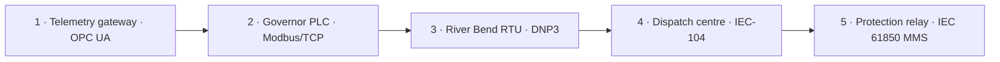

# OT — Prabal Urja

A five-stage OT training exercise following operator visibility, generation control, substation switching, dispatch communication, and relay protection. Each stage includes a Red Team walkthrough and a Blue Team investigation. All process effects occur in the training simulation.

| Scenario | Asset | Protocol | Objective | Writeups |
|---|---|---|---|---|
| [1: The Trusted Maintenance Window](Scenario1/README.md) | `PU-OPCUA-GW-01` | OPC UA | Freeze operator telemetry and suppress alarms | [Red](Scenario1/Red-Team/Red-Writeup-S1.md) · [Blue](Scenario1/Blue-Team/Blue-Writeup-S1.md) |
| [2: Silent Generation Bias](Scenario2/README.md) | `PU-GOV-PLC-02` | Modbus/TCP | Raise generation from 650 MW to 720 MW | [Red](Scenario2/Red-Team/Red-Writeup-S2.md) · [Blue](Scenario2/Blue-Team/Blue-Writeup-S2.md) |
| [3: Rogue DNP3 Master](Scenario3/README.md) | `PU-RB-RTU-07` | DNP3 | Transfer 620 MW onto Feeder B through switching | [Red](Scenario3/Red-Team/Red-Writeup-S3.md) · [Blue](Scenario3/Blue-Team/Blue-Writeup-S3.md) |
| [4: IEC-104 Session Integrity](Scenario4/README.md) | `Northern Load Dispatch Centre` | IEC 60870-5-104 | Disrupt fresh dispatch telemetry | [Red](Scenario4/Red-Team/Red-Writeup-S4.md) · [Blue](Scenario4/Blue-Team/Blue-Writeup-S4.md) |
| [5: Protection Setting Manipulation](Scenario5/README.md) | `PU-DSS-IED-01` | IEC 61850 MMS | Raise protection pickup from 800 A to 1600 A | [Red](Scenario5/Red-Team/Red-Writeup-S5.md) · [Blue](Scenario5/Blue-Team/Blue-Writeup-S5.md) |

## How to follow the exercise

Start with Scenario 1 and follow the engineering clue at the end of each stage. Obtain each scenario’s assigned address from the platform or instructor. The clues connect the investigation; the deployments provide the network access for each stage.

Read the Red Team version for discovery, protocol operations and process impact. Read the Blue Team version for detection, investigation and recovery procedures. Recovery instructions use expected states to guide the operator.

Scenario 4 uses a supplied gateway to run a fixed 95-second communication experiment. The other Red Team stages use industrial clients to interact with the exposed scenario interfaces.

## Addresses in the walkthroughs

`<ip>` represents an address supplied for the current deployment. Red Team Bash/Zsh examples use an interactive `TARGET` variable. For Blue Team commands, use the address of the role named in the step; local services and internal master/outstation peers can use different addresses. Keep port numbers and protocol identifiers as shown.
