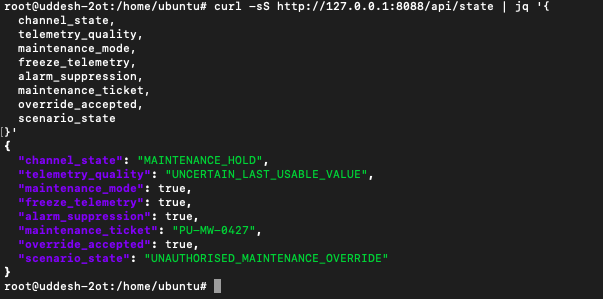
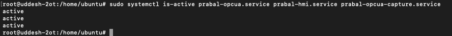
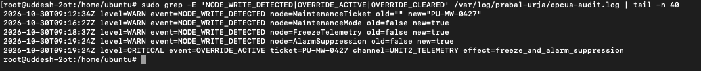
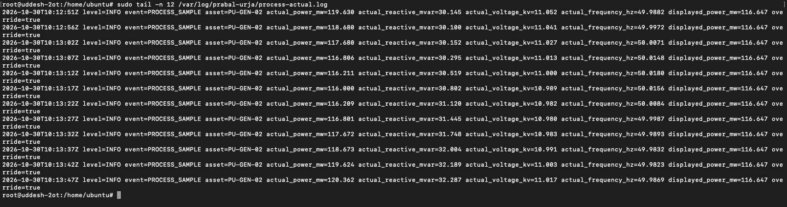
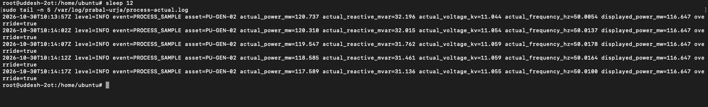
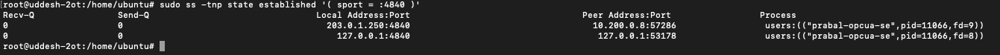
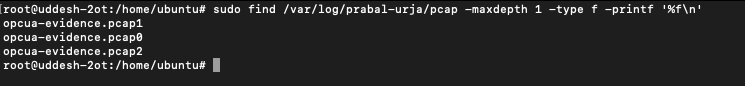
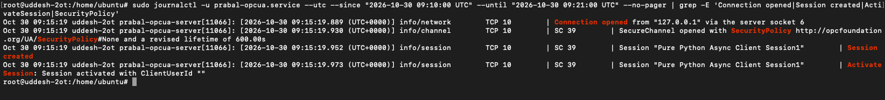

# Prabal Urja | Scenario 1 | Blue Team Investigation and Recovery

[Exercise overview](../../README.md) · [Scenario 1](../README.md) · [Other team](../Red-Team/README.md)

## Starting information

This is the starting point: investigate the Unit-2 telemetry gateway and its maintenance controls.

Use the address assigned to this scenario by the exercise platform or instructor. Each stage has its own assigned deployment. Follow the engineering clue to identify the next asset, then open that stage using its assigned address.

Run host commands on the assigned defender VM. Replace `<ip>` in each command with the address for the named role: local service, legitimate master, outstation, or participant. Packet filters comparing two endpoints require their respective addresses.

**Walkthrough:** Detection → event and network investigation → containment or restoration procedures → operational checks.


**Challenge:** The Trusted Maintenance Window  
**Evidence date:** 30 October 2026  
**Affected asset:** `PU-OPCUA-GW-01`, Unit 2  
**Exercise server:** `<ip>`  
**Scope:** Investigate the demonstrated OPC UA telemetry-integrity incident, preserve the evidence, restore the normal application state and validate the CTF scoring check. This procedure does not alter the challenge's persistent access configuration.

## 1. Incident summary

The Red Team connected to a real open62541 OPC UA server and modified maintenance variables exposed to an anonymous client. The approved work-order reference was discovered by reading `EngineeringMetadata/LastApprovedWorkOrder`; it was not guessed. The accepted combination of `MaintenanceTicket`, `MaintenanceMode`, `FreezeTelemetry` and `AlarmSuppression` caused the operator's telemetry to enter `MAINTENANCE_HOLD` while the underlying time-dependent process simulation continued changing.

## 2. Detection: inspect the live state

Run on the Ubuntu challenge host:

```bash
curl -sS http://<ip>:8088/api/state | jq '{channel_state,telemetry_quality,maintenance_mode,freeze_telemetry,alarm_suppression,maintenance_ticket,override_accepted,scenario_state}'
```

The captured response showed:

| Field | Observed value |
|---|---|
| Channel | `MAINTENANCE_HOLD` |
| Data quality | `UNCERTAIN_LAST_USABLE_VALUE` |
| Maintenance mode | `true` |
| Freeze telemetry | `true` |
| Alarm suppression | `true` |
| Maintenance ticket | `PU-MW-0427` |
| Override accepted | `true` |
| Scenario state | `UNAUTHORISED_MAINTENANCE_OVERRIDE` |



## 3. Distinguish process integrity from service uptime

```bash
sudo systemctl is-active prabal-opcua.service prabal-hmi.service prabal-opcua-capture.service
```

All three services returned `active`. This does **not** mean the telemetry was trustworthy: the CTF's corrected Service Availability TTP treats a verified telemetry-integrity compromise as a scoring failure and returns `SERVICE_STATUS:DOWN` with exit code `1` while the services may still run normally.



## 4. Reconstruct the actual attack timeline

```bash
sudo grep -E 'NODE_WRITE_DETECTED|OVERRIDE_ACTIVE|OVERRIDE_CLEARED' /var/log/prabal-urja/opcua-audit.log | tail -n 40
```

| Time (UTC), 30 Oct 2026 | Verified audit event |
|---|---|
| 09:12:34 | `MaintenanceTicket` changed from empty to `PU-MW-0427` |
| 09:16:27 | `MaintenanceMode` changed from `false` to `true` |
| 09:18:37 | `FreezeTelemetry` changed from `false` to `true` |
| 09:19:24 | `AlarmSuppression` changed from `false` to `true` |
| 09:19:24 | `OVERRIDE_ACTIVE`, `effect=freeze_and_alarm_suppression` |

**Interpretation:** the audit shows server-side variable changes and activation of the vulnerable application logic. It is not, by itself, proof of which client IP performed each write.



## 5. Prove actual telemetry is diverging from displayed telemetry

```bash
sudo tail -n 12 /var/log/prabal-urja/process-actual.log
sleep 12
sudo tail -n 5 /var/log/prabal-urja/process-actual.log
```

Representative values visible in the collected screenshots:

| Process sample | Actual power (MW) | Displayed power (MW) |
|---|---:|---:|
| Initial | 119.630 | 116.647 |
| Later | 118.680 | 116.647 |
| Later | 116.000 | 116.647 |
| Later | 120.362 | 116.647 |
| Follow-up | 117.589 | 116.647 |

This is the technical result of the exercise. The source implements a **simulated** generating process; it is not a measurement from physical generating equipment. The operator display is stale even while the internal simulated values change.





## 6. Investigate network attribution, without guessing

Inspect current sessions and packet files:

```bash
sudo ss -tnp state established '( sport = :4840 )'
sudo find /var/log/prabal-urja/pcap -maxdepth 1 -type f -printf '%f\n'
```

Review historical sessions during the **write times**:

```bash
sudo journalctl -u prabal-opcua.service --utc --since '2026-10-30 09:10:00 UTC' --until '2026-10-30 09:21:00 UTC' --no-pager | grep -E 'Connection opened|Session created|ActivateSession|SecurityPolicy'
```

The provided journal excerpt at **09:15:19 UTC** shows a connection from `<ip>` and a `Pure Python Async Client Session1`. This is a local session, not proof of the attacker. A later socket snapshot showed a connection from `<ip>`, but that snapshot was taken after the malicious writes. Neither observation establishes who performed the writes. Historical packet analysis would be needed for stronger attribution.







## 7. Restore normal operation for the exercise

On an authorised OPC UA client, browse:

`Objects → Prabal Urja → HydroPlant → Unit2 → TelemetryGateway`

Use the variable's **Write Value** operation to restore the following values in this order:

| Variable | Recovery value |
|---|---|
| `AlarmSuppression` | `false` (Boolean) |
| `FreezeTelemetry` | `false` (Boolean) |
| `MaintenanceMode` | `false` (Boolean) |
| `MaintenanceTicket` | Empty String |

The server's application code evaluates the override condition continuously. Clearing an individual required Boolean deactivates it; clearing the remaining variables and ticket returns the lab to an ordinary baseline.

Do not restart the host or use the exercise reset script merely to clear the incident. Both would interfere with the investigation record or exercise state.

## 8. Confirm recovery and scoring

```bash
curl -sS http://<ip>:8088/api/state | jq '{channel_state,telemetry_quality,maintenance_mode,freeze_telemetry,alarm_suppression,maintenance_ticket,override_accepted,scenario_state}'
```

Expect `ONLINE`, `GOOD`, the three Boolean maintenance controls `false`, the ticket empty, `override_accepted=false`, and `NORMAL_OPERATION`. Check that power starts changing again:

```bash
curl -sS http://<ip>:8088/api/state | jq '.active_power_mw'
sleep 8
curl -sS http://<ip>:8088/api/state | jq '.active_power_mw'
```

