# Scenario 01: The Trusted Maintenance Window

**Prabal Urja Hydroelectric Power Station | Red Team practical write-up**

**Exercise:** Unit-2 operations console and OPC UA telemetry gateway  
**Target in this run:** `<ip>`  
**Red Team workstation:** Any network-connected system with a compatible OPC UA client (Windows, Linux or macOS). The screenshots show Prosys OPC UA Browser as one tested example.  
**Observed date:** 30 October 2026  
**Server:** Native open62541 OPC UA application; HMI polls the OPC UA namespace  
**Scope:** Authorised, isolated OT cyber range only

> **Platform-neutral instructions.** This challenge does not require a MacBook or a specific operating system. Use any Windows, Linux, macOS or other workstation that can reach the isolated lab and run a suitable OPC UA client. The screenshots show one Prosys client session, not an installation requirement. Menu labels may differ, but the OPC UA node operations and server responses are what matter.

> **Evidence standard.** The OPC UA connection, reads, writes, maintenance-state change, HMI result and scoring-check failure are evidenced by the screenshots and terminal output supplied during the exercise. Independent physical-process divergence and a routable Scenario 2 transition are **not** yet evidenced and are listed as outstanding tests. Do not present either as confirmed.

## 1. Objective and observed result

The Red Team objective was to determine whether an anonymous OPC UA client could misuse the Unit-2 maintenance pathway to hold the operator's displayed telemetry and inhibit alarms without shutting down the service.

**Observed outcome:** the operator HMI changed from `NORMAL_OPERATION` to `UNAUTHORISED_MAINTENANCE_OVERRIDE`. The HMI displayed `MAINTENANCE_HOLD`, `UNCERTAIN_LAST_USABLE_VALUE`, `Override: ACCEPTED`, `Alarm Suppression: YES` and `Freeze Request: YES`. The dashboard-scoring check then returned `SERVICE_STATUS:DOWN` with exit code `1` while real protocol and web services remained available.

| Evidence item | What the exercise actually demonstrated |
| --- | --- |
| Native OPC UA communication | Prosys connected to `opc.tcp://<ip>:4840`, server identified as an open62541-based OPC UA application |
| Insecure access path | Security Mode `None` and `Anonymous` accepted for this deployment |
| Engineering-data exposure | `LastApprovedWorkOrder` read as `PU-MW-0427` |
| Unauthorised write | `MaintenanceTicket` successfully changed and read back from the server |
| Maintenance controls | `MaintenanceMode`, `FreezeTelemetry` and `AlarmSuppression` set to `true`; final HMI confirms all three |
| Operational application effect | Accepted override, maintenance hold, reduced data quality, alarms inhibited in the simulated HMI |
| CTF score condition | `SERVICE_STATUS:DOWN`, `TTP_EXIT_CODE=1` observed in the Ubuntu scoring test |
| Scenario 2 clue | `PU-GOV-PLC-02` and `Modbus/TCP` exposed; no Scenario 2 network route verified |

## 2. Reconnaissance and baseline

### 2.1 Confirm the target's listening services

On the Red Team machine, the relevant authorised ports are:

```bash
nmap -Pn -sV -p 4840,8088 <ip>
```

- TCP **4840** is the OPC UA endpoint.
- TCP **8088** hosts the read-only Unit-2 operator HMI.

**Why:** distinguish the industrial protocol endpoint from the operator website. The HMI is an observer; the write-capable interface in this challenge is OPC UA.

Open `http://<ip>:8088/` and capture the state **before** any writes. The observed baseline was `NORMAL_OPERATION`, maintenance `INACTIVE`, channel `ONLINE`, override `NOT ACCEPTED`, and data quality `GOOD`.

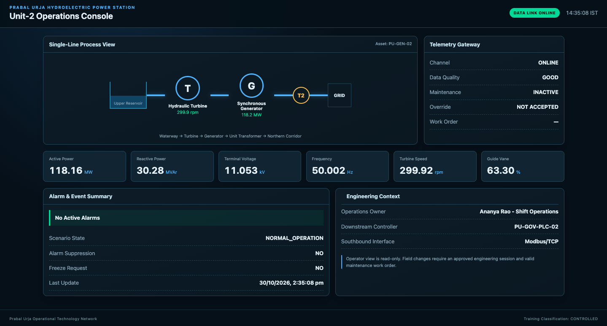

*Figure 04. Operator HMI before the attack, with normal channel and telemetry quality.*

### 2.2 Connect with a real OPC UA client

On any compatible Red Team workstation, install an OPC UA client that supports browsing, reading and writing nodes. **Prosys OPC UA Browser** is used in the recorded screenshots, but it is not compulsory. Other OPC UA clients with equivalent functionality are suitable. Enter this server endpoint in your client:

```text
opc.tcp://<ip>:4840
```

Choose **Security Mode: None** and **User Authentication: Anonymous**, because those options were offered by this specific lab server. Do not assume that other OPC UA deployments permit them.

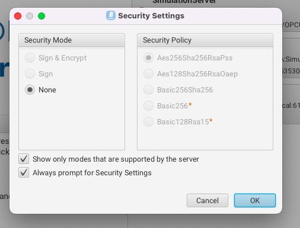

*Figure 01. Prosys security settings with Security Mode None selected.*

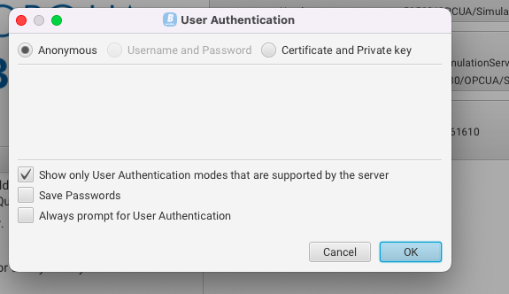

*Figure 02. Anonymous authentication selected in Prosys OPC UA Browser.*

Click **OK** and wait for the client status to show **Running** with the open62541-based application connected.

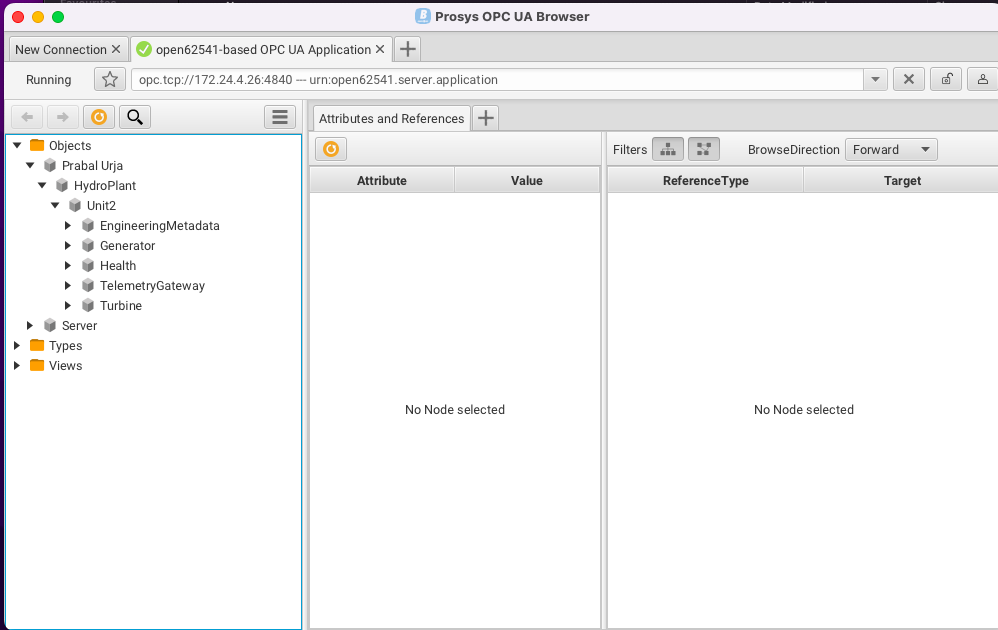

*Figure 03. Live open62541 server connection and expanded Unit2 address space.*

**Why:** this exercises actual OPC UA endpoint negotiation, authentication and namespace reads. A successful TCP connection alone would not establish that an industrial client can interact with the server.

## 3. Discover engineering context and write permissions

### 3.1 Browse the address space

In the left panel of Prosys, expand:

```text
Objects
  Prabal Urja
    HydroPlant
      Unit2
        EngineeringMetadata
        Generator
        Health
        TelemetryGateway
        Turbine
```

Expand **EngineeringMetadata**. Select `LastApprovedWorkOrder`, then read its **Value** field in **Attributes and References**. The observed value was `PU-MW-0427` and its `AccessLevel` was `CurrentRead` only.

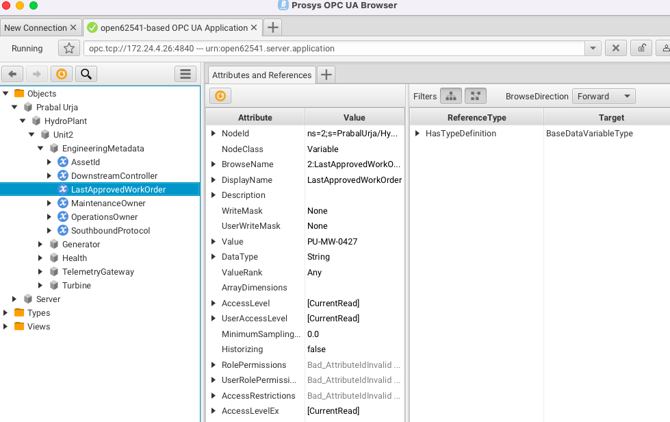

*Figure 05. LastApprovedWorkOrder returns PU-MW-0427 as read-only engineering metadata.*

Read `DownstreamController` and `SouthboundProtocol` in the same folder. The HMI and server expose `PU-GOV-PLC-02` and `Modbus/TCP`. These are real field values, but they do not provide an IP address or demonstrate reachability to Scenario 2.

### 3.2 Inspect the vulnerable maintenance path

Expand **TelemetryGateway**. The actual server namespace exposes:

```text
AlarmBanner
AlarmSuppression
ChannelState
FreezeTelemetry
MaintenanceMode
MaintenanceTicket
OverrideAccepted
TelemetryQuality
```

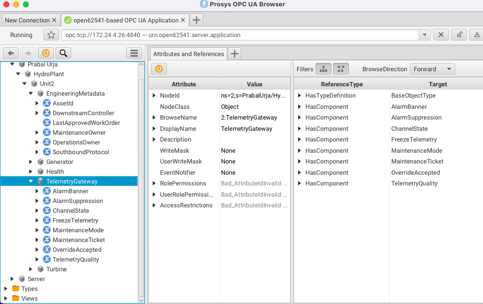

*Figure 06. TelemetryGateway exposes maintenance variables in the server namespace.*

Click each of the four maintenance inputs and inspect **Value**, **DataType**, and **UserAccessLevel**. In the observed session, `MaintenanceTicket` was a String; `MaintenanceMode`, `FreezeTelemetry` and `AlarmSuppression` were Booleans. The writes were subsequently accepted and read back by the anonymous client.

**Why this is a vulnerability:** the approved work-order identifier is readable as operational metadata, but possession of that identifier is not proof of an authorised maintenance operator. The server nevertheless accepts maintenance-control writes from the anonymous session in this range build.

## 4. Perform the maintenance override in Prosys

All actions below were performed on the isolated Scenario 1 exercise server. In the Prosys example, **right-click → Write Value…**. In a different OPC UA client, select its equivalent write or edit-value action. The node names, types, values and read-back checks remain identical.

### 4.1 Write the approved maintenance reference

1. Under **TelemetryGateway**, right-click `MaintenanceTicket` and select **Write Value…**.
2. Enter the exact String `PU-MW-0427`.
3. Click **Write**. Re-select the variable and press the orange **Refresh** button.
4. Confirm the server returns `Value = PU-MW-0427`.

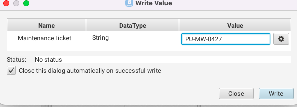

*Figure 07. MaintenanceTicket write dialog with the discovered work-order reference.*

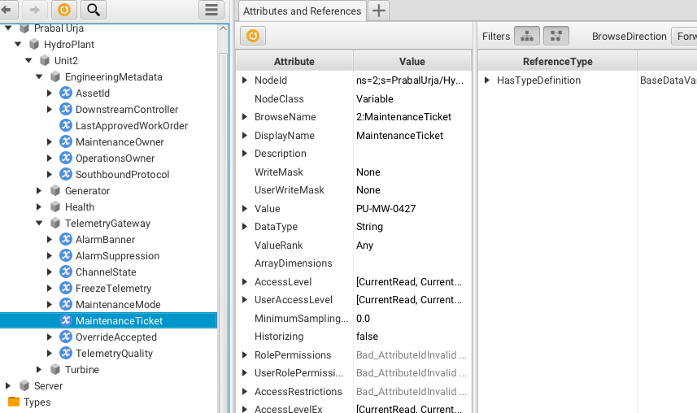

*Figure 08. MaintenanceTicket returns PU-MW-0427 after the write.*

**Why:** the maintenance-control condition uses the reference obtained from engineering metadata. The successful read-back confirms the value was written to the live OPC UA server.

### 4.2 Activate the maintenance state

1. Right-click `MaintenanceMode` → **Write Value…**.
2. Tick the Boolean checkbox to select **True**; click **Write**.
3. Refresh the variable to verify its value.

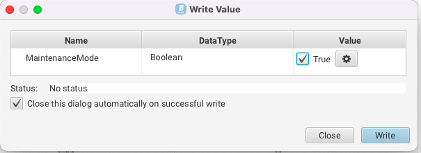

*Figure 09. Prosys dialog selecting True for MaintenanceMode.*

The HMI then showed maintenance **ACTIVE**, the channel as `MAINTENANCE_PENDING` and work order `PU-MW-0427`, while the override remained **NOT ACCEPTED**. This is important intermediate evidence: setting maintenance mode alone did **not** complete the objective.

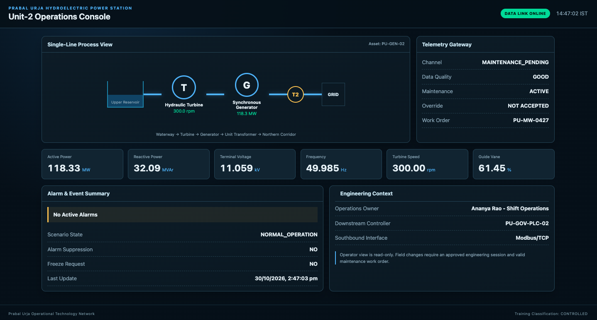

*Figure 10. HMI shows maintenance active, valid work order and maintenance-pending channel.*

### 4.3 Request frozen telemetry

1. Right-click `FreezeTelemetry` → **Write Value…**.
2. Select Boolean **True**, click **Write** and refresh.
3. The read-back showed `FreezeTelemetry = true`.

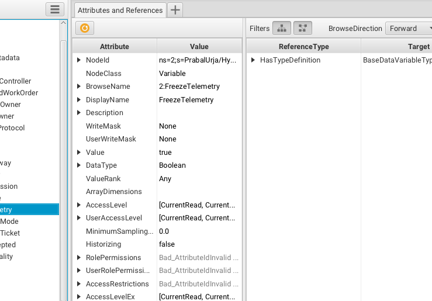

*Figure 11. FreezeTelemetry reads back true through OPC UA.*

**Why:** this input requests that the server hold the values delivered to the operator telemetry path. The input alone is not proof that an effect occurred; the final HMI state must also be checked.

### 4.4 Request alarm suppression

1. Right-click `AlarmSuppression` → **Write Value…**.
2. Select Boolean **True**, click **Write** and refresh.
3. The read-back showed `AlarmSuppression = true`.

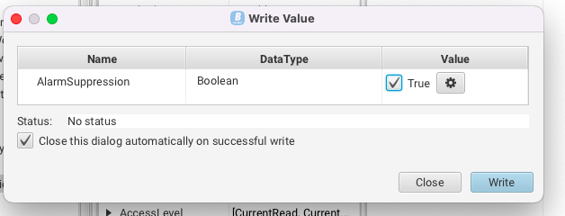

*Figure 12. Prosys dialog selecting True for AlarmSuppression.*

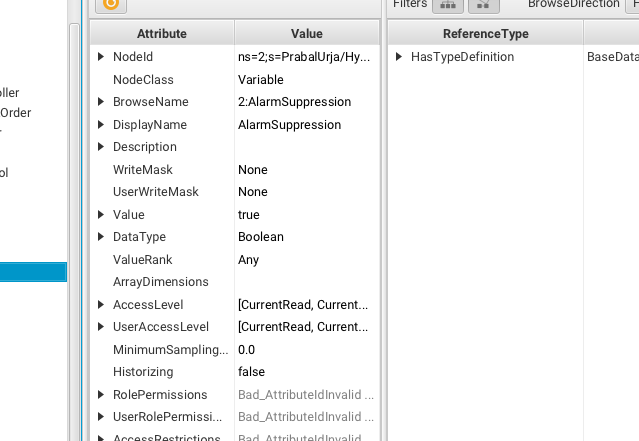

*Figure 13. AlarmSuppression reads back true through OPC UA.*

### 4.5 Confirm the accepted override

After all four maintenance inputs were set, the live HMI displayed:

| Field | Observed value |
| --- | --- |
| Channel | `MAINTENANCE_HOLD` |
| Data Quality | `UNCERTAIN_LAST_USABLE_VALUE` |
| Maintenance | `ACTIVE` |
| Override | `ACCEPTED` |
| Work Order | `PU-MW-0427` |
| Freeze Request | `YES` |
| Alarm Suppression | `YES` |
| Scenario State | `UNAUTHORISED_MAINTENANCE_OVERRIDE` |

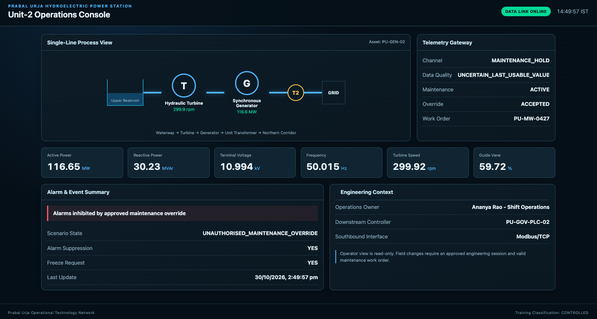

*Figure 14. HMI confirms MAINTENANCE_HOLD and UNAUTHORISED_MAINTENANCE_OVERRIDE.*

**Observed HMI values at 14:49:57 IST:** active power **116.65 MW**, reactive power **30.23 MVAr**, terminal voltage **10.994 kV**, frequency **50.015 Hz**, turbine speed **299.92 rpm**, guide vane **59.72%**. These are displayed measurements at one point in time, not proof of physical-process divergence.

## 5. Confirm the effect through independent interfaces

### 5.1 Read the live HMI state API

From a Bash-compatible terminal with `curl` and `jq` installed (Linux, macOS, WSL, or the exercise Ubuntu VM):

```bash
curl -sS http://<ip>:8088/api/state | jq '{connected,channel_state,telemetry_quality,override_accepted,maintenance_ticket,freeze_telemetry,alarm_suppression,scenario_state,downstream_controller,southbound_protocol}'
```

The actual terminal response supplied during the exercise contained:

```json
{
  "connected": true,
  "channel_state": "MAINTENANCE_HOLD",
  "telemetry_quality": "UNCERTAIN_LAST_USABLE_VALUE",
  "maintenance_mode": true,
  "freeze_telemetry": true,
  "alarm_suppression": true,
  "maintenance_ticket": "PU-MW-0427",
  "override_accepted": true,
  "scenario_state": "UNAUTHORISED_MAINTENANCE_OVERRIDE",
  "downstream_controller": "PU-GOV-PLC-02",
  "southbound_protocol": "Modbus/TCP"
}
```

This is an excerpt of fields from the observed response, not an additional screenshot.

**Windows PowerShell alternative (no Bash or jq required):**

```powershell
Invoke-RestMethod -Uri "http://<ip>:8088/api/state" | Select-Object connected, channel_state, telemetry_quality, override_accepted, scenario_state
```

### 5.2 Distinguish service health from a scored operational failure

During the attack, the **original** health-only TTP returned `SERVICE_STATUS:UP` because systemd, ports and functional OPC UA/HMI probes were healthy. The updated **scoring** check examines the actual scenario state and returned:

```text
SERVICE_STATUS:DOWN | REASON:ATTACK_DETECTED_OPCUA
TTP_EXIT_CODE=1
```

**Why:** in this range, `DOWN` is a Blue Team scoring failure because telemetry integrity has been compromised. It does **not** mean the OPC UA service or port 4840 crashed. Actual scoreboard point deductions still depend on dashboard integration and policy.

### 5.3 Independent process versus displayed telemetry: test still required

The server source includes an independent simulated-process logger. To establish manipulation-of-view beyond the accepted override state, compare the process log and repeated displayed values while the hold is active:

On Ubuntu:

```bash
sudo grep -E 'NODE_WRITE_DETECTED|OVERRIDE_ACTIVE' /var/log/prabal-urja/opcua-audit.log | tail -n 20
sudo tail -n 8 /var/log/prabal-urja/process-actual.log
sleep 12
sudo tail -n 8 /var/log/prabal-urja/process-actual.log
```

From a Bash-compatible terminal with `curl` and `jq` installed:

```bash
for i in 1 2 3; do
  curl -sS http://<ip>:8088/api/state | jq '{active_power_mw,frequency_hz,override_accepted}'
  sleep 6
done
```

**Pass criterion:** during `override=true`, `actual_power_mw` changes in `/var/log/prabal-urja/process-actual.log` while `displayed_power_mw` and the HMI's active-power reading remain constant. The supplied materials do not yet include these log samples. Attach them before claiming that particular comparison is proven.

> **[PENDING IMAGE SLOT P1]** Insert a real Ubuntu terminal screenshot showing two `PROCESS_SAMPLE` records with changing `actual_power_mw` and unchanged `displayed_power_mw`. Do not create a synthetic screenshot.

> **[PENDING IMAGE SLOT P2]** Insert repeated real `/api/state` results showing constant displayed power during the same time interval.

## 6. Scenario 1 to Scenario 2 discovery

The genuine information visible through the OPC UA engineering metadata and final HMI is:

```text
DownstreamController = PU-GOV-PLC-02
SouthboundProtocol   = Modbus/TCP
```

That establishes the **identity and protocol** of the next engineering asset, not a working network handoff. No Scenario 2 target IP, controller route, or actual Modbus response has been demonstrated in the supplied evidence. The next exercise must map `PU-GOV-PLC-02` to a real deployed endpoint and verify native Modbus communication before the transition can be called complete.

> **[PENDING IMAGE SLOT P3]** Insert a real Scenario 2 controller discovery / Modbus client screenshot after it has been tested. No IP or command result is supplied here because none has been confirmed.

## 7. Restore and collect evidence

After documenting the compromise, use the same OPC UA client (or another compatible client) on the **same isolated lab** to reverse the writes. In this order:

| Variable | Restored value |
| --- | --- |
| `AlarmSuppression` | `False` |
| `FreezeTelemetry` | `False` |
| `MaintenanceMode` | `False` |
| `MaintenanceTicket` | Empty String |

Refresh `OverrideAccepted` and `Health/ScenarioState`, then refresh the HMI. Expected normal-state values are `OverrideAccepted=false` and `ScenarioState=NORMAL_OPERATION`. **Restoration has not been shown in the supplied screenshots**, so this remains a required end-of-exercise check.

On Ubuntu, preserve original event evidence using the source package's collector:

```bash
sudo bash /opt/prabal-urja/scenario1/tools/collect_evidence.sh
```

The collector exports journals, `opcua-audit.log`, `process-actual.log`, available packet captures and checksums to a timestamped archive under `/var/tmp/prabal-s01-evidence-*` by default.

After recovery, rerun the updated scoring TTP. Expect `SERVICE_STATUS:UP` with exit code `0` if the scenario has truly returned to normal and both services pass their protocol checks.
