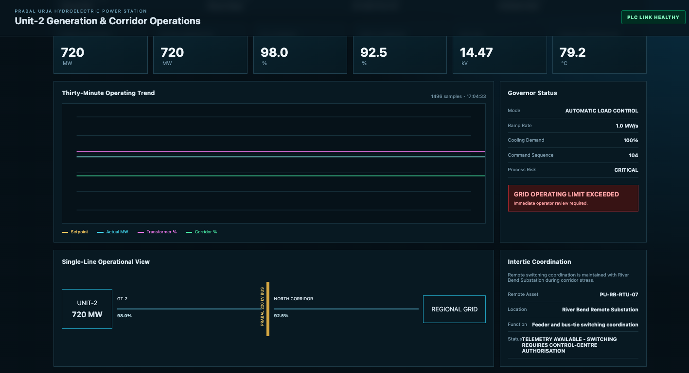
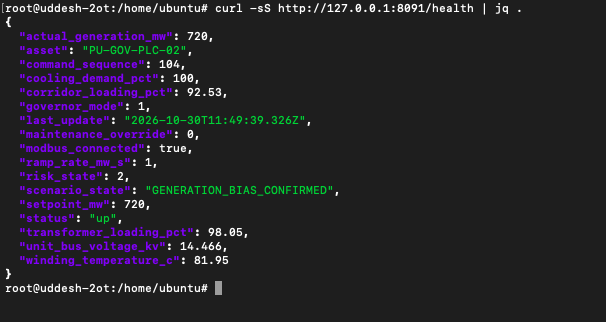
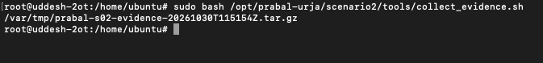
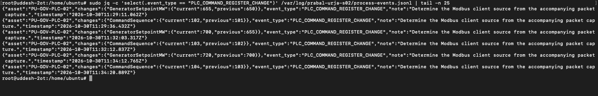
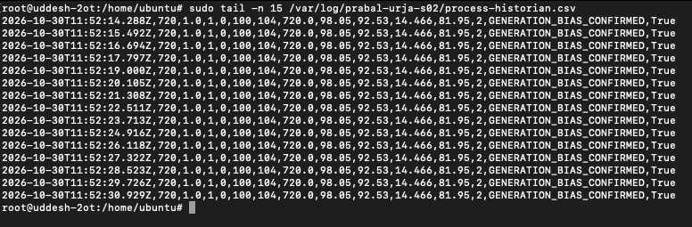
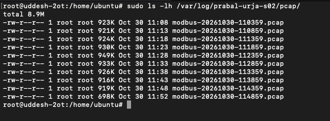
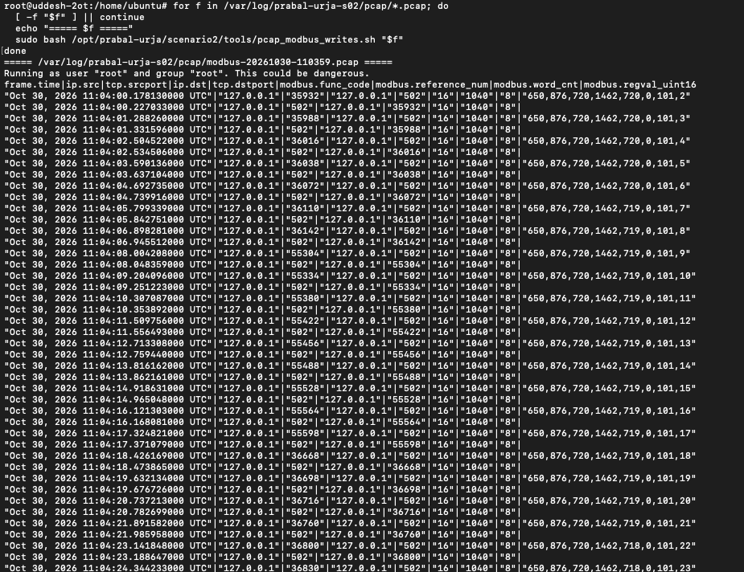
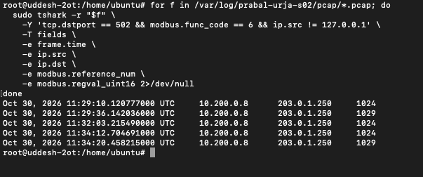
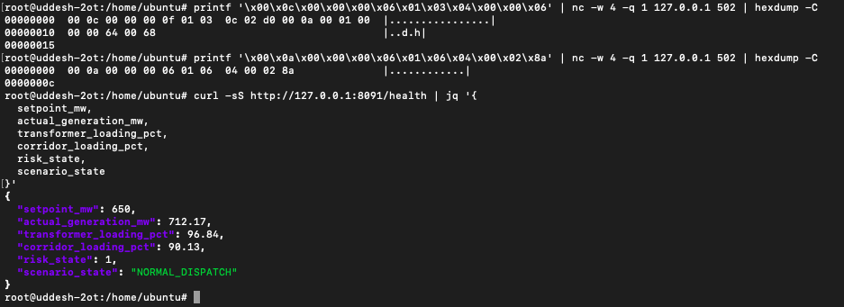
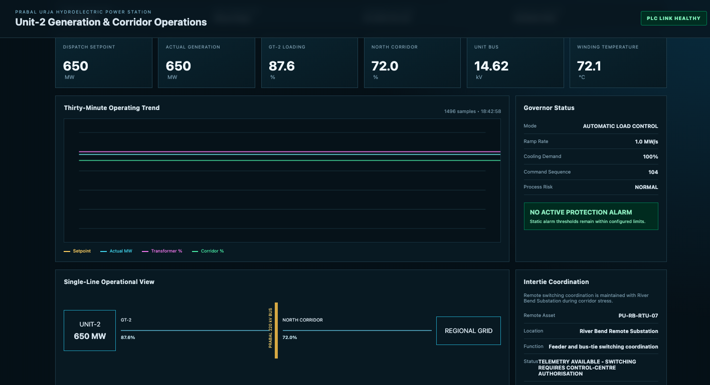

# Prabal Urja | Scenario 02 - Blue Team Investigation & Recovery

**Scenario:** Silent Generation Bias  
**System:** `PU-GOV-PLC-02`, OpenPLC with native Modbus/TCP and pandapower process simulation  
**Exercise host:** `<ip>` (participant-facing), TCP/502, operator console TCP/8090, simulator TCP/8091  
**Date of exercise:** 30 October 2026  
**Classification:** Isolated OT cyber-range exercise  
**Method:** Evidence-first incident response, operational recovery without hardening

> **Verified outcome:** The Blue Team identified the unauthorised setpoint changes, preserved an evidence archive, correlated Modbus captures with the process historian, restored the setpoint to 650 MW and observed the simulator return to 650 MW with normal risk and no active protection alarm. **A final successful `SERVICE_STATUS:UP` result from the revised scoring TTP was not supplied**, so dashboard recovery is not independently verified. No hardening was performed by design.

## 1. Incident overview and what the team observed

During the Red Team exercise, a remote Modbus/TCP client used function code `06` (Write Single Register) to alter the Unit-2 governor generator-setpoint register, address `1024`, from its approved 650 MW baseline through 655 MW and 700 MW to 720 MW. The command-sequence register at address `1029` advanced from 101 to 104. The real OpenPLC service accepted the writes; the pandapower-based simulator calculated elevated generator output and equipment loading. The operator console displayed a **CRITICAL** process risk and the grid-health API declared `GENERATION_BIAS_CONFIRMED`.



**Initial assessment:** The industrial service had not necessarily crashed. The CTF availability check was configured to fail when the simulator confirmed a harmful operating state. Distinguish protocol-service availability from safe process operation when triaging this incident.

| Metric | Approved baseline | Compromised state | Verified recovered state |
|---|---:|---:|---:|
| Governor setpoint | 650 MW | 720 MW | 650 MW |
| Actual simulated generation | 650 MW | 720 MW | 650 MW |
| Transformer loading | 87.6% | 98.05% | 87.6% |
| North corridor loading | 72.0% | 92.53% | 72.0% |
| Process risk | NORMAL | CRITICAL | NORMAL |
| Scenario state | NORMAL_DISPATCH | GENERATION_BIAS_CONFIRMED | Normal operating condition displayed; API confirmation of final state not separately supplied |

## 2. Detect and triage the abnormal operating state

Run the following on the **Scenario 2 Ubuntu host** to capture the current process state. It is a read-only API call.

```bash
curl -sS http://<ip>:8091/health | jq '{asset,setpoint_mw,actual_generation_mw,transformer_loading_pct,corridor_loading_pct,risk_state,scenario_state,modbus_connected}'
```

**Reason:** It confirms whether the PLC is linked, what dispatch is commanded, how much generation the simulator actually calculates, and whether the application has declared the attack condition. In the captured evidence, `setpoint_mw=720`, `actual_generation_mw=720`, `transformer_loading_pct=98.05`, `corridor_loading_pct=92.53`, `risk_state=2`, `scenario_state=GENERATION_BIAS_CONFIRMED`, and `modbus_connected=true`.



Check application services separately:

```bash
sudo systemctl is-active prabal-openplc.service prabal-grid-simulator.service prabal-operator-console.service prabal-modbus-capture.service
sudo ss -lntp | grep -E ':(502|8090|8091)\b'
```

**Reason:** Modbus connections can still be healthy during a harmful setpoint manipulation. The CTF dashboard's `DOWN` is a scoring condition, not necessarily an OpenPLC outage.

## 3. Preserve evidence before changing the PLC

The actual Scenario 2 source documents its evidence under `/var/log/prabal-urja-s02/`, not the Scenario 1 log directory. The collection script was run successfully:

```bash
sudo bash /opt/prabal-urja/scenario2/tools/collect_evidence.sh
```

**Actual returned archive:**

```text
/var/tmp/prabal-s02-evidence-20261030T115154Z.tar.gz
```



For reproducible custody of evidence, collect a checksum (this was **not shown as performed** in the supplied screenshots):

```bash
sudo sha256sum /var/tmp/prabal-s02-evidence-20261030T115154Z.tar.gz
sudo tar -tzf /var/tmp/prabal-s02-evidence-20261030T115154Z.tar.gz | head -n 40
```

Keep the archive unmodified. Never run a challenge reset or delete rolling PCAPs before completing forensic collection.

## 4. Reconstruct the unauthorised PLC register changes

Read the event records emitted by the running simulator:

```bash
sudo jq -c 'select(.event_type == "PLC_COMMAND_REGISTER_CHANGE")' /var/log/prabal-urja-s02/process-events.jsonl | tail -n 25
```

**Reason:** The event log provides an application-level history of the command-register transitions. It does not independently identify the sending IP address, so it must be correlated with PCAP evidence.

The provided screenshot records these transitions:

| Change | Previous value | New value | Field |
|---|---:|---:|---|
| Initial bias | 650 | 655 MW | `GeneratorSetpointMW` |
| Sequence update | 101 | 102 | `CommandSequence` |
| Further bias | 655 | 700 MW | `GeneratorSetpointMW` |
| Sequence update | 102 | 103 | `CommandSequence` |
| Final bias | 700 | 720 MW | `GeneratorSetpointMW` |
| Sequence update | 103 | 104 | `CommandSequence` |



The observed final changes in the screenshot occurred at approximately **11:34:12 and 11:34:20 UTC** on 30 October 2026. These are simulator log timestamps, not an inferred timeline from the display clock.

## 5. Demonstrate the real simulated process impact

```bash
sudo tail -n 15 /var/log/prabal-urja-s02/process-historian.csv
```

**Reason:** The historian records the sustained relationship among commanded setpoint, actual MW, transformer loading, corridor loading, risk and scenario state. A single setpoint write would be insufficient proof of the outcome.

The provided historian rows repeatedly show: setpoint **720 MW**, actual output **720 MW**, transformer **98.05%**, corridor **92.53%**, risk code `2`, and `GENERATION_BIAS_CONFIRMED`.



This establishes a working **simulated** electrical-process effect. It does not imply that physical generation equipment was controlled.

## 6. Locate and examine the Modbus packet captures

The PCAPs were present under the source-verified directory:

```bash
sudo ls -lh /var/log/prabal-urja-s02/pcap/
```



The first broad extraction contained large quantities of loopback traffic, especially function code `16` writes to process-feedback address `1040`. Those packets are **not evidence of the external malicious setpoint writes**.



Isolate remote function code `06` writes directed to Modbus TCP/502:

```bash
for f in /var/log/prabal-urja-s02/pcap/*.pcap; do
  [ -f "$f" ] || continue
  sudo tshark -r "$f" \
    -Y 'tcp.dstport == 502 && modbus.func_code == 6 && ip.src != <ip>' \
    -T fields -e frame.time -e ip.src -e ip.dst \
    -e modbus.reference_num -e modbus.regval_uint16 2>/dev/null
done
```

**Observed network evidence:** Five external FC06 requests are visible in the shared capture output. They originate from `<ip>`, target `<ip>`, and write registers `1024` and `1029`. These addresses reflect the capture vantage point. The participant-facing server address was `<ip>`; a network translation or overlay may explain the difference, but no network mapping was supplied to prove it.



**Attribution:** `<ip>` is confirmed as the **observed source IP of the remote Modbus writes**. The identity of the person/workstation behind it is not independently verified. The `modbus.regval_uint16` field was blank in that extraction, so values are established by the event log and HMI, not claimed as directly decoded from this PCAP output.

## 7. Restore the approved 650 MW dispatch

The Blue Team intentionally performed **operational restoration without applying firewall or authorised-master hardening**. The evidence archive had already been collected.

The provided recovery screenshot shows a native Modbus function code 03 read followed by a function code 06 write to register `1024` with value 650 MW. On Ubuntu, Netcat accepts `-w` and `-q`, not macOS's `-G` option.

```bash
# Read register state before a recovery write
printf '\x00\x0c\x00\x00\x00\x06\x01\x03\x04\x00\x00\x06' | nc -w 4 -q 1 <ip> 502 | hexdump -C

# In this recorded run, restore generator setpoint register 1024 to decimal 650
printf '\x00\x0a\x00\x00\x00\x06\x01\x06\x04\x00\x02\x8a' | nc -w 4 -q 1 <ip> 502 | hexdump -C
```

**Reason:** The first read checks the live PLC baseline. The second sends a real Modbus Write Single Register request. Its echoed reply and subsequent process state support that the setpoint write took effect. These literal frames are evidence of this specific exercise; in a new run, verify the current register map and command state first.



Immediately after the write, the API showed `setpoint_mw=650`, `actual_generation_mw=712.17`, transformer **96.84%**, corridor **90.13%**, and `risk_state=1`, while `scenario_state` had already cleared to `NORMAL_DISPATCH`. That is **partial operational recovery**, not the final settled state.

The later HMI screenshot retains **command sequence 104**, so the proposed optional sequence advance to 105 is **not verified as executed**. No claim is made that it was.

## 8. Verify the final recovered process state

The operator-console screenshot taken later shows the simulator has settled at the approved operating point:

| Indicator | Observed at end |
|---|---:|
| Dispatch setpoint | 650 MW |
| Actual generation | 650 MW |
| Transformer loading | 87.6% |
| Northern corridor loading | 72.0% |
| Governor mode | Automatic load control |
| Governor ramp rate | 1.0 MW/s |
| Process risk | NORMAL |
| Protection alarm | No active protection alarm |
| Command sequence | 104 (unchanged in supplied final screenshot) |



### Required final scoring verification (not yet provided)

Run the **corrected** Scenario 2 Service Availability TTP through the CTF platform. Confirm that it reports `SERVICE_STATUS:UP` and exit code `0` **after** sustained normal operation. Capture its output for the write-up.

```bash
# Read-only final process confirmation
curl -sS http://<ip>:8091/health | jq '{setpoint_mw,actual_generation_mw,transformer_loading_pct,corridor_loading_pct,risk_state,scenario_state}'
```

<!-- IMAGE PLACEHOLDER 11: Add screenshot of the final corrected TTP output showing SERVICE_STATUS:UP and exit code 0. Suggested filename: images/12-final-ttp-up.png -->

**Scoring design caveat:** In the intermediate recovery screenshot the simulator reported `NORMAL_DISPATCH` while generation remained at 712.17 MW and risk was stressed. If the TTP checks only `scenario_state`, it can return `UP` prematurely. For accurate Blue Team scoring, include safe operating thresholds or a sustained healthy-recovery state in the TTP. This improvement was identified, but a revised live scoring result is not present in the evidence supplied here.

## 9. Blue Team findings and scope

**Confirmed root cause in this lab:** The Modbus/TCP control path accepts reachable clients' permitted holding-register writes without authenticated-master authorisation. The governor control state changes and the pandapower simulator responds with a genuine calculated loading change.

**Verified:** OpenPLC and simulator functioning; Red Team's external FC06 write requests; application event chronology; sustained overload; evidence collection; 650 MW recovery; normal process/console values at end.

**Not verified:** Final scoring TTP return to `UP`; real-world operator identity behind `<ip>`; native interconnection to Scenario 3. The console displays River Bend RTU identifier `PU-RB-RTU-07`, but that does not prove that the DNP3 endpoint is reachable.

**Exercise recovery scope:** No hardening, allowlist, firewall change, or challenge reset is included, per exercise requirements. This makes the simulated attack repeatable; it is not a recommended production incident-response stopping point.
