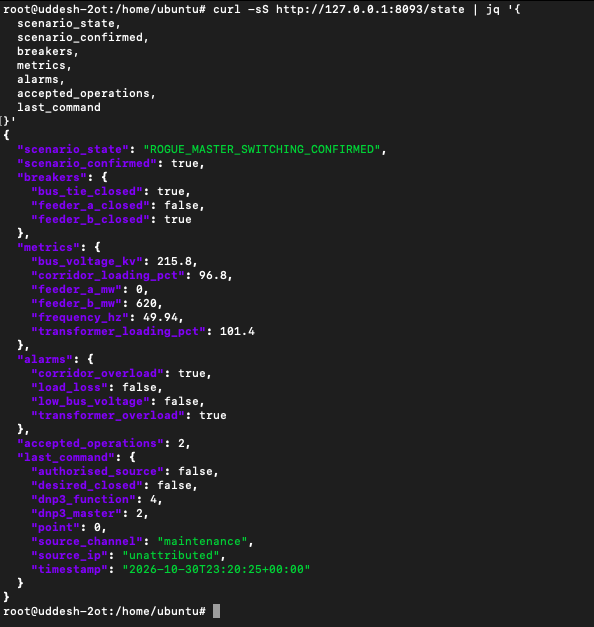
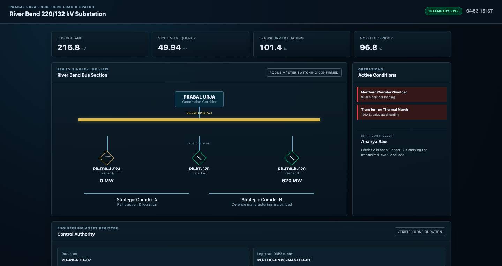
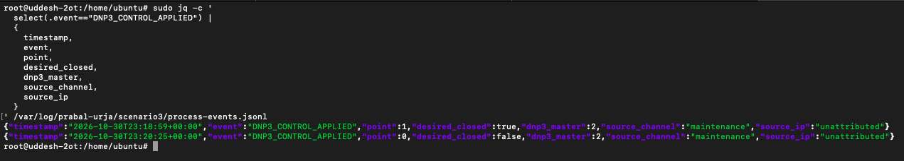
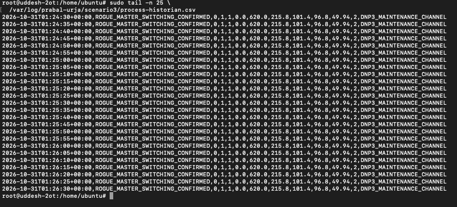
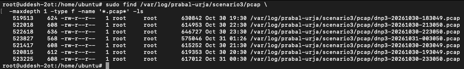
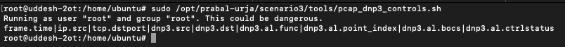
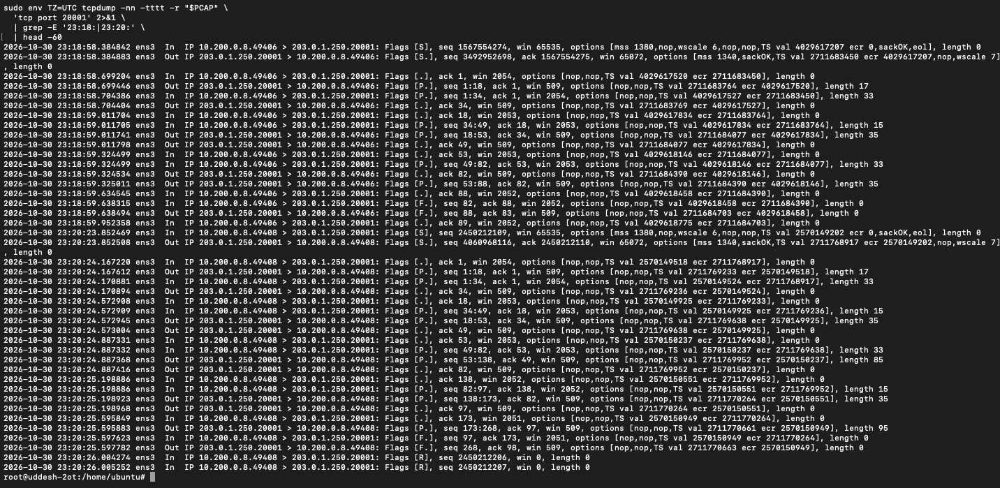
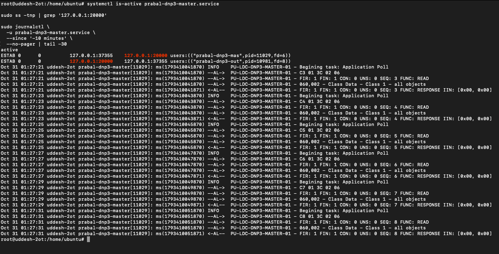
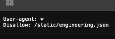
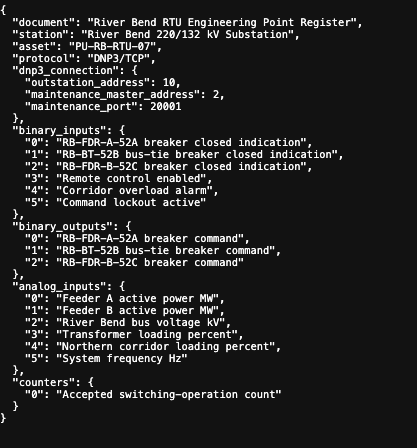

# Prabal Urja | Scenario 03: Rogue DNP3 Master

## Blue Team Investigation and Recovery Runbook

> **Scope and integrity:** This report concerns the authorised Prabal Urja simulated OT environment. It records what the Blue Team actually observed and separates proposed response actions from completed actions. The equipment, electrical loading and alarms are simulator outputs, not claims about a physical substation.

## 1. Incident summary

The River Bend RTU accepted two switching controls over its maintenance DNP3 channel. The first closed the bus tie. The second opened Feeder A. The resulting simulated configuration routed the combined 620 MW feeder load onto Feeder B. The process marked the scenario `ROGUE_MASTER_SWITCHING_CONFIRMED`, with transformer loading of **101.4%** and corridor loading of **96.8%**.

The CTF's deployed availability check previously returned `SERVICE_STATUS:DOWN | REASON:ROGUE_MASTER_ATTACK_CONFIRMED`. This represents a **process integrity failure**, not a loss of DNP3 service. At the time of Blue Team investigation, the legitimate DNP3 master remained active and polling.

| Observation | Verified value |
|---|---|
| Process state | `ROGUE_MASTER_SWITCHING_CONFIRMED` |
| Confirmed incident | `true` |
| Feeder A / bus tie / Feeder B | Open / Closed / Closed |
| Feeder A / Feeder B load | 0 MW / 620 MW |
| Bus voltage / frequency | 215.8 kV / 49.94 Hz |
| Transformer / north corridor loading | 101.4% / 96.8% |
| Active alarms | `transformer_overload=true`, `corridor_overload=true` |
| Accepted switching operations | 2 |
| Origin recorded by simulator | Maintenance channel; source IP `unattributed` |



*Evidence 01. The process API returns the compromised breaker configuration, 620 MW on Feeder B, two accepted operations and the last unauthorised command.*

The operator's single-line display independently presented Feeder A at 0 MW, Feeder B at 620 MW, and the confirmed incident condition:



*Evidence 02. Operator dashboard showing the simulated operational consequence. The displayed loading is an output of the challenge process model.*

## 2. Reconstruct the switching sequence

The process application log contains two `DNP3_CONTROL_APPLIED` events. These are the strongest direct application-level records of the controls accepted by the simulator.

```bash
sudo jq -c '
  select(.event=="DNP3_CONTROL_APPLIED") |
  {timestamp,event,point,desired_closed,dnp3_master,source_channel,source_ip}
' /var/log/prabal-urja/scenario3/process-events.jsonl
```

**Observed records:**

```json
{"timestamp":"2026-10-30T23:18:59+00:00","event":"DNP3_CONTROL_APPLIED","point":1,"desired_closed":true,"dnp3_master":2,"source_channel":"maintenance","source_ip":"unattributed"}
{"timestamp":"2026-10-30T23:20:25+00:00","event":"DNP3_CONTROL_APPLIED","point":0,"desired_closed":false,"dnp3_master":2,"source_channel":"maintenance","source_ip":"unattributed"}
```



*Evidence 04. Both process-event records show DNP3 master address 2, maintenance-channel access and application of a breaker command.*

| Time (UTC, 30 Oct) | Time (IST, 31 Oct) | Control | Recorded effect |
|---|---|---|---|
| 23:18:59 | 04:48:59 | CROB point 1 | Bus tie closed |
| 23:20:25 | 04:50:25 | CROB point 0 | Feeder A opened |

These are **two distinct control operations**, not merely two protocol acknowledgements. However, `source_ip: "unattributed"` means the process log alone does not identify the original workstation address.

## 3. Confirm the operational impact in the historian

```bash
sudo tail -n 25 /var/log/prabal-urja/scenario3/process-historian.csv
```

The historian showed repeated records of the compromised state, with Feeder A at 0 MW, Feeder B at 620 MW, bus voltage 215.8 kV, frequency 49.94 Hz, transformer loading 101.4%, and corridor loading 96.8%.



*Evidence 05. Repeated historian samples show that the compromised condition persisted; these samples do not represent additional switching commands.*

The confirmed alarms were corridor overload and transformer overload. `load_loss` and `low_bus_voltage` were **false** in the captured state.

## 4. Investigate packet evidence and network origin

List the retained PCAP files:

```bash
sudo find /var/log/prabal-urja/scenario3/pcap   -maxdepth 1 -type f -name '*.pcap*' -ls
```



*Evidence 06. Several DNP3 packet captures were available, including one covering both incident timestamps.*

The provided helper was run without a specific capture argument:

```bash
sudo /opt/prabal-urja/scenario3/tools/pcap_dnp3_controls.sh
```

It printed the field headers but **no decoded control rows**. This does not establish that the commands are absent from the captures. The script chooses the most recent capture by default, and the existing `tshark` command-monitor had previously shown instability.



*Evidence 07. No decoded Select/Operate evidence was produced by this helper invocation.

The analyst then inspected the PCAP that covered the incident window:

```bash
PCAP=/var/log/prabal-urja/scenario3/pcap/dnp3-20261030-223050.pcap
sudo env TZ=UTC tcpdump -nn -tttt -r "$PCAP"   'tcp port 20001' 2>&1 |
  grep -E '23:18:|23:20:' | head -60
```

The TCP trace showed two connections to the DNP3 maintenance listener:

| Time (UTC) | Observed traffic |
|---|---|
| 23:18:58–23:18:59 | `<ip>:49406` to `<ip>:20001` |
| 23:20:23–23:20:25 | `<ip>:49408` to `<ip>:20001` |



*Evidence 08. TCP traffic to the maintenance listener coincides with both application control events.

## 5. Verify the legitimate DNP3 master remained healthy

```bash
systemctl is-active prabal-dnp3-master.service
sudo ss -tnp | grep '<ip>:20000'
sudo journalctl -u prabal-dnp3-master.service   --since '-10 minutes' --no-pager | tail -30
```

The service was `active`. The socket listing showed an established local connection to `<ip>:20000`, while the journal showed continuing `PU-LDC-DNP3-MASTER-01` application polls and DNP3 responses.



*Evidence 09. The legitimate control-centre master remained connected and polling, distinguishing unauthorised switching from a loss of the DNP3 service.*

The defensive goal is therefore to restrict the exposed maintenance path while retaining legitimate master communications.

## 6. Examine the web-based engineering disclosure

The operator website's root `/robots.txt` was verified to expose this path:

```text
User-agent: *
Disallow: /static/engineering.json
```



*Evidence 10. The publicly accessible crawler instructions disclose the engineering document path.*

The document itself disclosed outstation address `10`, maintenance master address `2`, maintenance port `20001`, and the mapping of breaker indications and CROB points.



*Evidence 11. The exposed engineering register provides the configuration needed to interpret DNP3 point indices.*

An analyst may look for such records in the Python operator-console service journal:

```bash
sudo journalctl -u prabal-riverbend-console.service --no-pager |
  grep -E 'GET /robots.txt|GET /static/engineering.json'
```

This site uses a Python HTTP handler rather than Apache.

## 7. Technical finding and root cause

The installed maintenance interface accepted DNP3 controls from an external client using the configured master address `2`, and the process recorded `authorised_source: false`. This permitted an unauthorised workstation to control the simulated breaker outputs. The engineering document made the address and control-point mapping discoverable once the website clue was added.

The case establishes a **challenge-specific maintenance-channel access-control failure**. It does not show that DNP3 devices in general accept commands from any network host or that the legitimate master was compromised.

The two applied controls caused the simulated transfer of load to Feeder B and triggered transformer and corridor overload conditions. CTF scoring previously confirmed:

```text
SERVICE_STATUS:DOWN | REASON:ROGUE_MASTER_ATTACK_CONFIRMED
```

## 8. Containment and restoration runbook (recovery procedure)

Coordinate changes with the exercise controller; this is a training simulator.

### 8.1 Contain remote maintenance access

```bash
sudo /opt/prabal-urja/scenario3/tools/apply_hardening.sh
sudo systemctl enable prabal-s03-hardening.service
sudo nft list table inet prabal_s03
```

With no authorised maintenance IP provided, the package's `apply_hardening.sh` adds an nftables rule blocking **non-loopback** access to DNP3 ports `20000` and `20001`. Loopback is left available so the local legitimate master can continue to poll. If a particular deployment requires a remote authorised maintenance master, an explicitly verified allowlist must be planned instead of indiscriminately blocking it.

Record the actual nftables table after the change, and test maintenance-port reachability from the authorised exercise client. Neither check has been supplied yet.

### 8.2 Restore the approved topology

```bash
sudo python3 /opt/prabal-urja/scenario3/tools/operator_restore.py   --operator "Blue Team"   --reason "Unauthorised DNP3 switching contained; restore approved River Bend topology"

sleep 3
curl -fsS http://<ip>:8093/state | jq '{
  scenario_state,scenario_confirmed,breakers,metrics,alarms,last_restore
}'
```

The packaged restoration helper creates an authorised **process restoration request**. It does not itself perform the two reverse breaker operations via DNP3. This distinction must be made clear in the lab assessment.

### 8.3 Verify operational recovery

Expected conditions after successful recovery:

| Check | Expected normal condition |
|---|---|
| Feeder A / bus tie / Feeder B | Closed / Open / Closed |
| Feeder A / Feeder B | 318 MW / 302 MW |
| Transformer loading | Approximately 84.2% |
| Corridor loading | Approximately 78.6% |
| Scenario state | `NORMAL_SWITCHING_CONFIGURATION` |
| Scenario confirmed | `false` |
| Legitimate DNP3 master | Active, connected and polling |
| Remote unauthorised maintenance control | Blocked |
| Deployed CTF availability TTP | `SERVICE_STATUS:UP` |

Check the process and HMI health endpoints and the legitimate-master socket.

```bash
curl -fsS http://<ip>:8093/health | jq .
curl -fsS http://<ip>:8092/api/health | jq .
systemctl is-active prabal-dnp3-outstation.service   prabal-dnp3-master.service   prabal-riverbend-process.service   prabal-riverbend-console.service
```
