# Prabal Urja | Scenario 04
## Blue Team SOC Investigation: IEC-104 Session Integrity

### SOC case summary

| Field | Case finding |
|---|---|
| Protected service | Native IEC 60870-5-104 master/outstation link |
| Legitimate master | `<ip>` |
| Legitimate outstation | `<ip>:2404` |
| HMI/API | `<ip>:8095` (local defender view) |
| Relevant training VPN source | `<ip>` |
| Disruption observed | Repeated disconnection cycles ~07:55 and 08:30-08:31 UTC |
| Strongest corroboration | Master logs + TCP resets + participant trigger journal |
| Containment | Stop `prabal-s04-participant-gateway.service` |
| Scope | Isolated simulation only; no physical process controlled |

---

### 01. Alert intake and initial triage

**Read-only commands (defender VM):**

```bash
curl -fsS http://<ip>:8095/api/state | python3 -m json.tool
curl -fsS http://<ip>:8095/api/incident | python3 -m json.tool
```

**Why:** Determine whether the legitimate master currently receives fresh telemetry and whether an earlier incident has been recorded. SOC triage should use live state plus history, not simply check whether HTTP responds.

**Observed:** At 08:39:14 UTC the live state was `DISPATCH_TELECONTROL_HEALTHY`, online `true`, master `DATA_RECEIVED`, receive count `2888` and telemetry age ~5.16 seconds. The incident endpoint was `RECORDED` with `record_type: operator_attested_prior_incident`.

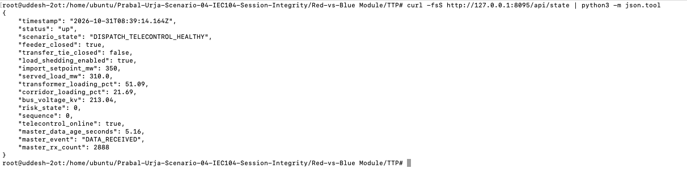

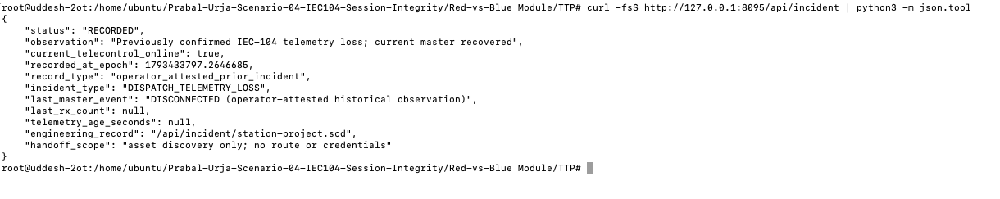

**Time validation:** The timestamp conversion screenshot establishes that the retained record was from **08:03:17 UTC on 31 October 2026**, earlier than the 08:30:13 UTC trigger. It should not be silently substituted for the later incident.

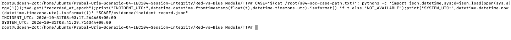

**Important:** The retained incident's `recorded_at_epoch` converts to **31 October 2026 08:03:17 UTC**. It precedes the separately observed **08:30:13** gateway trigger. The earlier record cannot by itself be used to establish the 08:30 incident timeline.

### 02. Open a SOC case and preserve initial state

**Commands:**

```bash
CASE="/root/S04-SOC-$(date +%Y%m%d-%H%M%S)"
mkdir -p "$CASE"/{evidence,screenshots,logs,pcap}
echo "$CASE" > /root/s04-soc-case-path.txt

CASE="$(cat /root/s04-soc-case-path.txt)"
date -Is > "$CASE/evidence/collection-time.txt"
curl -fsS http://<ip>:8095/api/state > "$CASE/evidence/scada-state.json"
curl -fsS http://<ip>:8095/api/incident > "$CASE/evidence/incident-record.json"
sha256sum "$CASE"/evidence/* > "$CASE/evidence/SHA256SUMS"
```

**Why:** Store source data with collection timestamps and hashes so another analyst can reproduce findings without relying on screenshots alone. `sha256sum` provides a file-integrity reference; it does not authenticate the source server.

**Observed:** The case directory was created as `/root/S04-SOC-20261031-083857/` and initial state was saved.

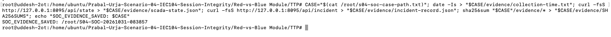

**Case-initiation screenshot:** The case directory was created first, before the API responses and hashes were saved.

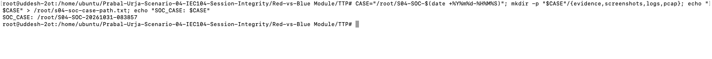

### 03. Establish the legitimate-master log timeline

**Command:**

```bash
CASE="$(cat /root/s04-soc-case-path.txt)"
journalctl -u prabal-iec104-master.service \
  -u prabal-iec104-outstation.service \
  --since '2026-10-31 00:00:00' --no-pager -o short-iso \
  | grep -Ei 'disconnect|connect|sequence|error|timeout|reset' \
  | tee "$CASE/logs/iec104-suspicious-events.log" | tail -60
```

**Why:** A normal IEC-104 exchange uses a persistent master/outstation session. Repeated connect/disconnect cycles are an incident indicator, although ordinary network failure can cause them too.

**Observed:** Repeated `LEGITIMATE_MASTER_DISCONNECTED`, `LEGITIMATE_MASTER_CONNECTED`, and outstation `CONNECTION_EVENT` log entries around **07:55** and **08:30-08:31 UTC**. The accepted connection source was `<ip>`.

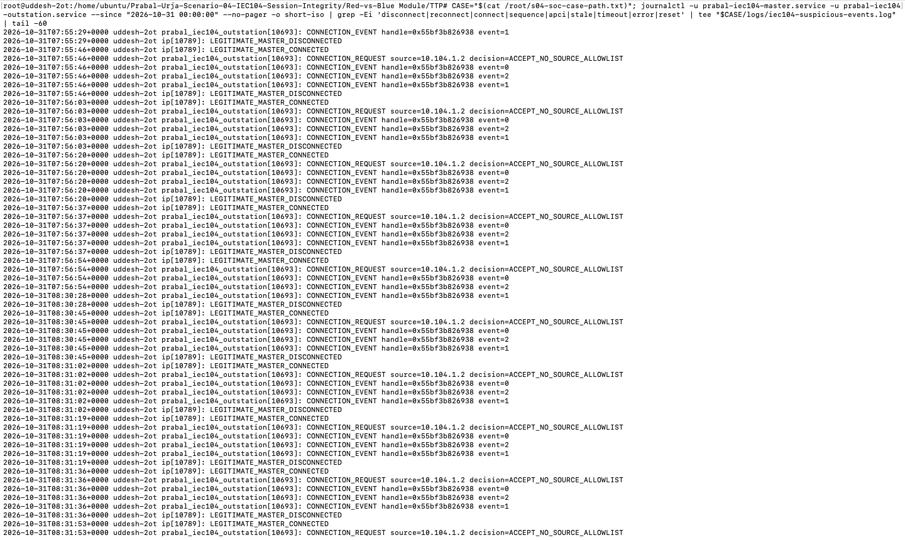

**Additional log context:** Normal `LEGITIMATE_MASTER_DATA` messages show the master also received frames during healthy intervals. Comparing them with disconnection entries avoids treating every journal line as an alert.

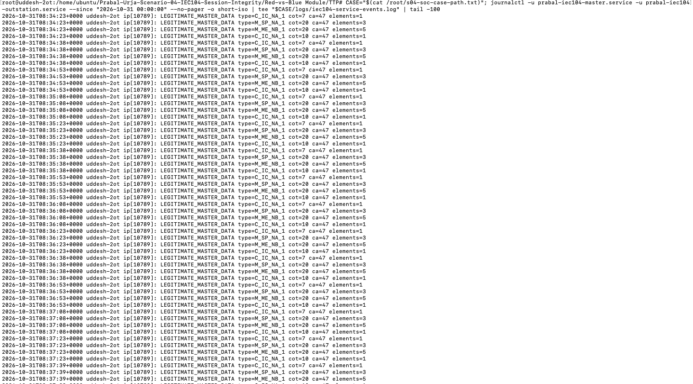

### 04. Check defender services and preserve network captures

**Commands:**

```bash
systemctl --no-pager is-active \
  prabal-iec104-master.service prabal-iec104-outstation.service \
  prabal-s04-command-monitor.service prabal-s04-capture.service

CASE="$(cat /root/s04-soc-case-path.txt)"
mkdir -p "$CASE/pcap"
cp -n /var/log/prabal-urja/scenario4/pcap/*.pcapng "$CASE/pcap/"
(cd "$CASE/pcap" && sha256sum *.pcapng > SHA256SUMS)
ls -lh "$CASE/pcap/"
```

**Why:** Confirm the monitored services are running and preserve raw traffic before analysis. The initial empty case folder was corrected by copying all four original `.pcapng` files and generating checksums. If a capture is actively being written, a consistent post-rotation acquisition is preferable.

**Observed:** All four queried services active; four captures preserved. Their names spanned original captures starting 05:35, 06:35, 07:35 and 08:35 UTC.

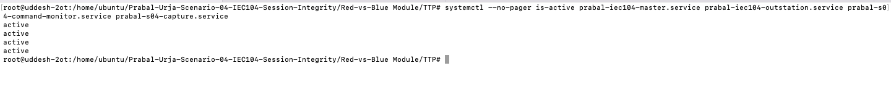

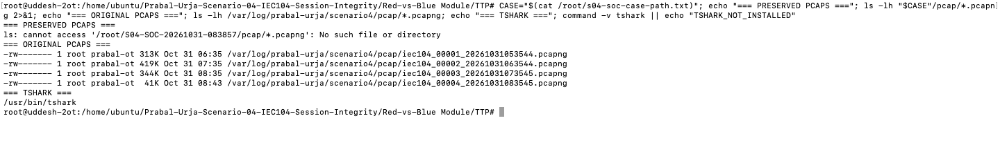

**Collection troubleshooting:** The first packet query returned no results because the case PCAP directory was empty. The original files were then identified and copied. Retain both screenshots to explain the corrected evidence workflow.


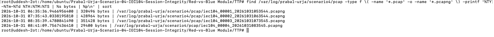

### 05. Decode APCI transmit and acknowledgement counters

**Command:**

```bash
CASE="$(cat /root/s04-soc-case-path.txt)"
for f in "$CASE"/pcap/*.pcapng; do
  echo "=== $(basename "$f") ==="
  tshark -r "$f" \
    -Y 'iec60870_104.tx && ip.src==<ip> && ip.dst==<ip>' \
    -T fields -E separator=, \
    -e frame.time -e tcp.stream -e iec60870_104.tx -e iec60870_104.rx \
    | head -20
done
```

**Why:** IEC-104 I-format frames carry `N(S)` and `N(R)`. The fields are read-only TShark dissector outputs. Inspect a single TCP stream and sequence progression before alleging sequence poisoning.

**Observed:** The selected outstation-to-master frames showed normally increasing counters, for example `960`, `961`, `962` and so on in one capture. No altered frame was established from this display.

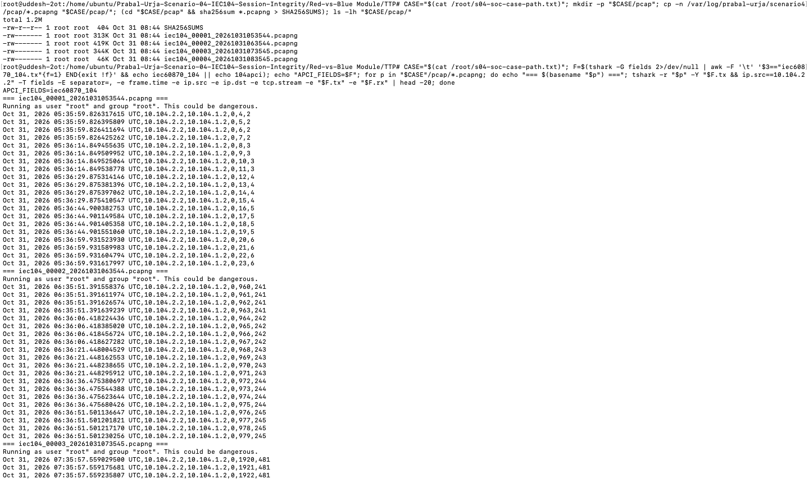

**Transport-level confirmation:** Before narrowing the query to APCI counters, the SOC confirmed actual packets between `<ip>` and `<ip>` with TCP port `2404`.

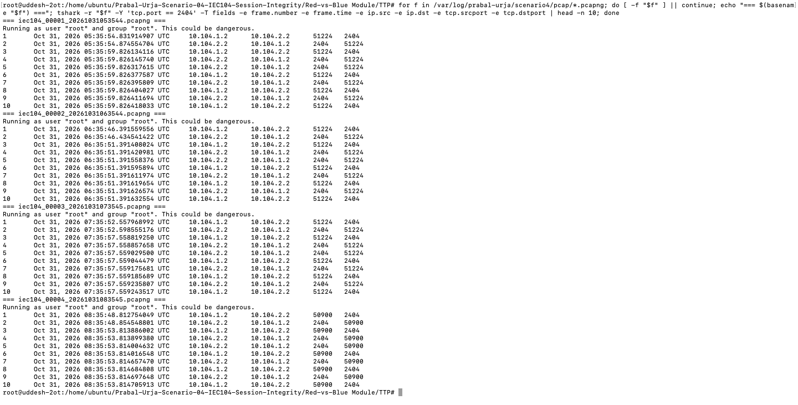

**Follow-up jump hunt:**

```bash
CASE="$(cat /root/s04-soc-case-path.txt)"
for f in "$CASE"/pcap/*.pcapng; do
  echo "=== $(basename "$f") ==="
  tshark -r "$f" -Y 'iec60870_104.tx && ip.src==<ip> && ip.dst==<ip>' \
    -T fields -E separator=, -e frame.number -e frame.time \
    -e tcp.stream -e iec60870_104.tx -e iec60870_104.rx 2>/dev/null \
    | awk -F, '{k=$3;if(k in prev){d=($4-prev[k]+32768)%32768;if(d>100 && d<32767)print "APCI_JUMP",$1,$2,k,prev[k],$4,d}prev[k]=$4}'
done
```

**Observed:** No matches. This is a **heuristic** (threshold 100), not a complete forensic proof. The capture uses `dumpcap -i any -f 'tcp port 2404'` and may have recorded packets before the NFQUEUE rewrite or missed the relevant stream. The clean jump hunt must not be reported as proof that no modification occurred.

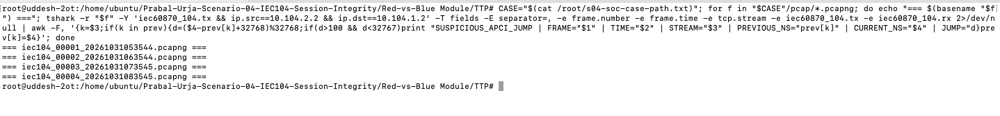

### 06. Filter unrelated traffic and identify SCADA TCP resets

**Command:**

```bash
CASE="$(cat /root/s04-soc-case-path.txt)"
for f in "$CASE"/pcap/*.pcapng; do
  echo "=== $(basename "$f") ==="
  tshark -r "$f" -Y 'tcp.port==2404 && ip.addr==<ip> && ip.addr==<ip> && (tcp.flags.reset==1 || tcp.analysis.retransmission || tcp.analysis.lost_segment)' \
    -T fields -E separator=, -e frame.time -e ip.src -e ip.dst \
    -e tcp.stream -e _ws.col.Info 2>/dev/null | head -25
done
```

**Why:** The interface-wide capture also contained traffic from unrelated hosts; those resets should not be attributed to the legitimate master. This filter restricts results to both SCADA endpoints.

**Observed:** Multiple TCP RST packets from `<ip>` to `<ip>:2404` around **07:55 UTC** and again **08:30-08:31 UTC**, matching the application-level instability.

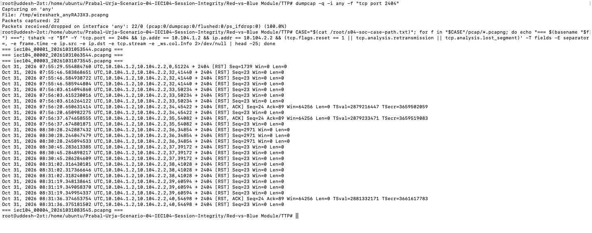

**Capture-methodology finding:** The capture unit used `dumpcap` on interface `any` with `tcp port 2404`. It also recorded other connections unrelated to the internal master/outstation session. That is why the later endpoint-pair filter was necessary. The existence of captures on `any` does not prove the modifier was observed after NFQUEUE processing.

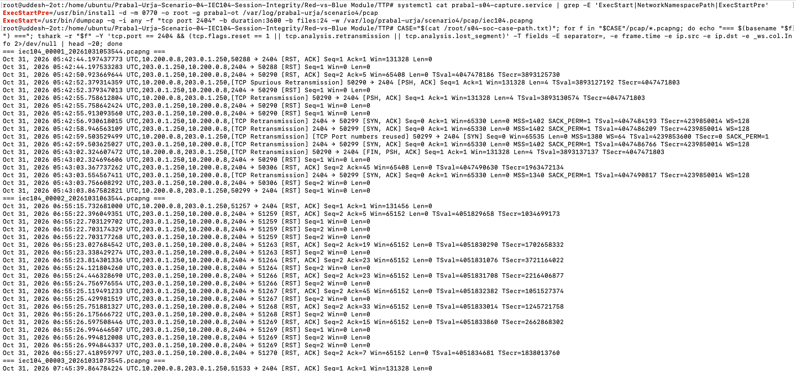

### 07. Correlate packet timeline with the service journal

**Commands:**

```bash
CASE="$(cat /root/s04-soc-case-path.txt)"
journalctl -u prabal-iec104-master.service \
  -u prabal-iec104-outstation.service \
  --since '2026-10-31 08:29:45' --until '2026-10-31 08:32:15' \
  --no-pager -o short-iso \
  | grep -Ei 'disconnect|connect|sequence|error|timeout|reset' \
  | tee "$CASE/logs/scada-incident-correlation.log"

tshark -r "$CASE/pcap/iec104_00003_20261031073545.pcapng" \
  -Y 'tcp.stream == 36 && (iec60870_104.tx || tcp.flags.reset==1)' \
  -T fields -E separator=, -e frame.time -e ip.src -e ip.dst \
  -e iec60870_104.tx -e iec60870_104.rx \
  -e tcp.flags.reset -e _ws.col.Info | tail -35
```

**Why:** Source-level event correlation is stronger than looking at a single alarming line. The packet at the master endpoint and the service journal should agree on the disruption time.

**Observed timeline:**

| UTC | Evidence |
|---|---|
| 08:30:13 | IEC-104 traffic exchanging normally immediately before disconnection |
| 08:30:28 | TCP reset from master to outstation; `LEGITIMATE_MASTER_DISCONNECTED` in journal |
| 08:30:45 | New connection attempt/acceptance and another master disconnect |
| 08:31:02 | Reconnection followed by another master disconnect |

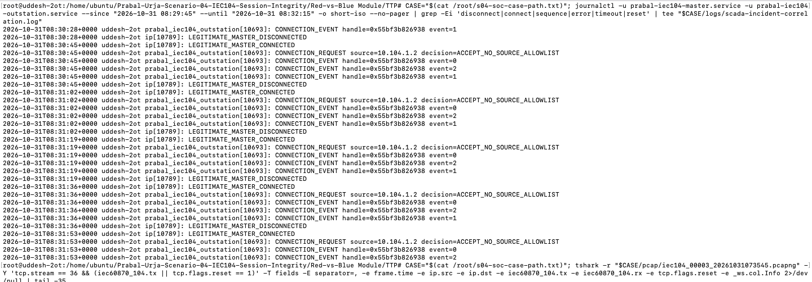

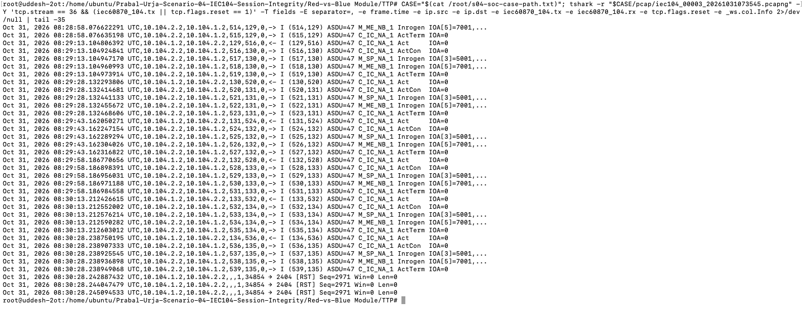

### 08. Identify the exercise trigger and check ongoing interference

**Command (read-only):**

```bash
CASE="$(cat /root/s04-soc-case-path.txt)"
{
  echo '=== TRANSIT FIREWALL RULES ==='
  ip netns exec pu-s04-transit iptables -S FORWARD
  echo '=== PACKET PROCESSING PROCESSES ==='
  ps -eo pid,ppid,lstart,args | grep -Ei '[n]fqueue|[a]pci_lab|[r]un-apci-lab' || true
  echo '=== HISTORICAL EVENTS ==='
  journalctl --since '2026-10-31 08:25:00' --until '2026-10-31 08:35:00' --no-pager \
    | grep -Ei 'NFQUEUE|iptables|apci|packet.modif|sequence' | tail -50 || true
} | tee "$CASE/logs/interference-investigation.log"
```

**Why:** A SOC analyst needs to establish the origin of interference, not simply see a service outage. The firewall/process checks are current-state checks; they cannot reconstruct a short-lived queue rule after it has been removed.

**Observed:** The journal contained `HMI_ACCESS source=<ip> 'POST /api/participant/apci HTTP/1.1' 202` and `APCI_GATEWAY <ip> 'POST /run HTTP/1.1' 202` at **08:30:13 UTC**. The first master disconnection followed at **08:30:28 UTC**, approximately 15 seconds later. The current FORWARD policy was ACCEPT, and no active modifier process was seen at investigation time.

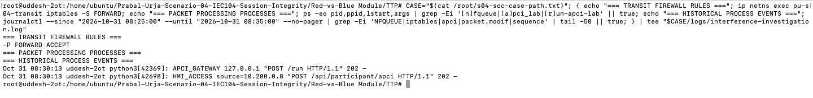

**Full time-window evidence:** The broader journal excerpt includes the accepted gateway request at 08:30:13 UTC, local API polling and the subsequent disconnections.

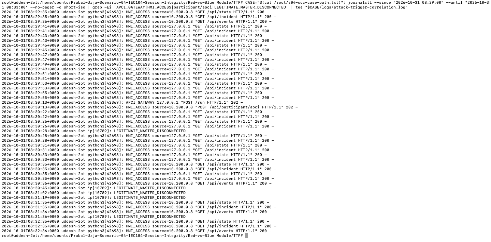

### 09. Apply lab-specific containment

**Command (authorised defender action):**

```bash
systemctl stop prabal-s04-participant-gateway.service
systemctl is-active prabal-s04-participant-gateway.service
```

**Why:** The observed gateway is a training control plane allowing another bounded experiment to be requested. Stopping it prevents **new** requests via that gateway while it remains stopped. It is not a general industrial IEC-104 countermeasure and does not necessarily terminate a currently running packet modifier.

**Observed:** `inactive`.

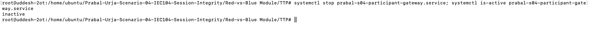
