# Prabal Urja | Scenario 04

[Exercise overview](../../README.md) · [Scenario 4](../README.md) · [Other team](../Blue-Team/Blue-Writeup-S4.md)

## Starting information

Scenario 3 identifies the dispatch control authority and IEC-104 telecontrol relationship. Investigate the legitimate master/outstation communication in this scenario.

Use the address assigned to this scenario by the exercise platform or instructor. Each stage has its own assigned deployment. Follow the engineering clue to identify the next asset, then open that stage using its assigned address.

**Exercise method:** The supplied participant gateway starts a fixed 95-second APCI sequence-modification experiment within the existing master/outstation path. The Red Team requests the experiment and observes its effect.

**Terminal setup:** In Bash or Zsh, enter the assigned address when prompted. Commands below use `TARGET`; replace `<ip>` with the same address in browser URLs and graphical clients.

```bash
printf "Assigned scenario address: "
read -r TARGET
export TARGET
```

**Walkthrough:** Objective → discovery → protocol actions → operational impact → next scenario.

## Red Team Walkthrough: IEC-104 Session Integrity

**Exercise date:** 31 October 2026  
**Module:** Red-vs-Blue, isolated OT training range  
**Participant platform:** macOS over the authorised training VPN (commands are also usable from another workstation with `curl` and Nmap)  
**Objective:** Demonstrate telemetry loss in the native IEC 60870-5-104 master/outstation link, verify the operational impact, and extract the Scenario 05 engineering handoff.

### Exercise scope and architecture

| Component | Observed value | Meaning |
|---|---|---|
| Training lab host | `<ip>` | Reachable across authorised VPN |
| IEC-104 service | TCP `2404` | Native outstation endpoint |
| Dispatch HMI/API | TCP `8095` | State, incident and controlled lab trigger |
| Legitimate SCADA master | `<ip>` | Internal master, separate from participant |
| Legitimate outstation | `<ip>:2404` | Internal IEC-104 peer |
| IEC-104 common address | `47` | Address confirmed during earlier protocol exploration |
| Participant VPN IP in this deployment | `<ip>` | Explicitly allowed by the training gateway |
| Internal experiment path | `pu-s04-transit` | Isolated NFQUEUE modification point |
| Experiment duration | 95 seconds | Bounded, restores normal forwarding at completion |

The Mac interacts with the **lab gateway** over HTTP `8095`. The privileged helper applies a fixed, bounded experiment within the **existing** legitimate master/outstation flow. A separate TCP connection from the Mac to port `2404` is not on-path and would not, by itself, change the master's APCI counters.

### What APCI sequence integrity means

IEC 60870-5-104 I-format APDUs carry sequence values `N(S)` (send count) and `N(R)` (acknowledgement count). The master and outstation use those counters to track the established data-transfer session. In this exercise a contained modifier changed selected outstation-to-master `N(S)` values. An unexpected sequence can cause the legitimate master to stop accepting fresh application telemetry or disconnect. **This is not an IEC-104 command injection or breaker operation.**

---

### 1. Discover the exposed services

**Command (participant terminal):**

```bash
nmap -Pn -sT -sV -p 2404,8095 "${TARGET}"
```

**Why:** Identify the native IEC-104 listener and HMI without scanning unrelated infrastructure. `-Pn` skips host discovery; `-sT` uses the operating system's TCP connect; `-sV` probes service fingerprints. A fingerprint is not proof of IEC-104 correctness.

**Observed:** TCP `2404` and `8095` were open. Nmap labelled the first `iec-104` and the second HTTP.

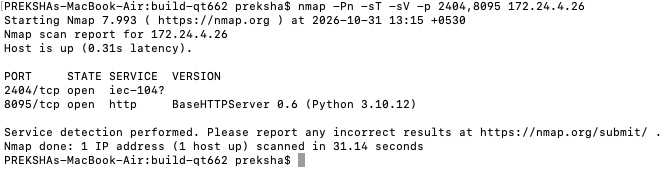

**Additional original reconnaissance screenshot:** The earlier scan explicitly shows both `2404/tcp open iec-104` and `8095/tcp open http`. Both scans are retained because this was the first Red Team activity.

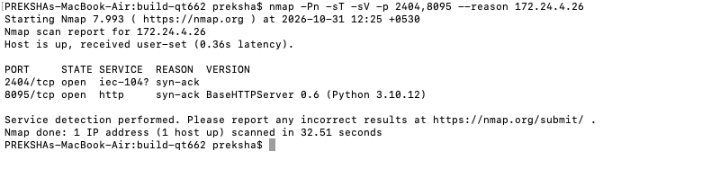

**TCP reachability and VPN route checks:** These confirm access to the assigned OT lab. `nc` verifies a socket can be opened; it does not authenticate an IEC-104 session. The route test confirms the network route, not an on-path foothold.

```bash
nc -G 3 -vz "${TARGET}" 2404
route -n get "${TARGET}"
```

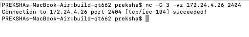

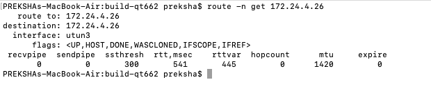

### 2. Establish a healthy telemetry baseline

**Command:**

```bash
curl -fsS http://${TARGET}:8095/api/state | python3 -m json.tool
```

**Why:** An attack impact can be assessed only relative to a known-good native-master state. `python3 -m json.tool` formats the returned JSON; it does not modify the lab.

**Observed:** `DISPATCH_TELECONTROL_HEALTHY`, `telecontrol_online: true`, `master_event: DATA_RECEIVED`, positive `master_rx_count` and low telemetry age.

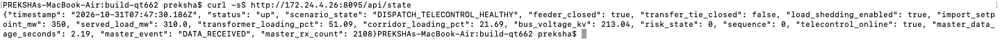

**Supporting healthy-state evidence:** Before the APCI exercise, the HMI displayed online SCADA and operating measurements. A separate terminal comparison showed changing receive counts while communication was healthy.

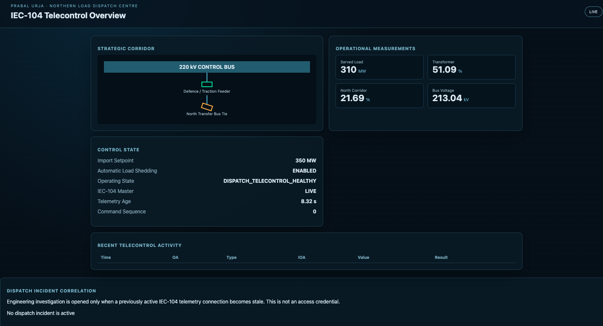

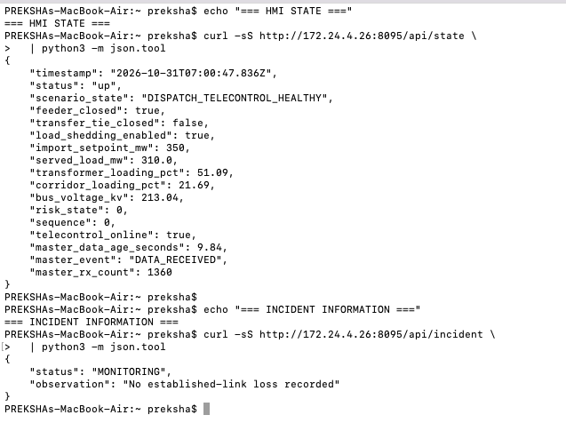

**Passive packet observation from the Mac (supporting reconnaissance, not the exploit):** The participant used `tcpdump` on the VPN interface to observe packets associated with the exposed IEC-104 endpoint. This proves traffic visibility on the participant's own connection; it does **not** establish access to the master/outstation internal traffic path.

```bash
sudo tcpdump -i utun3 -nn -s 0 "host ${TARGET} and tcp port 2404"
```

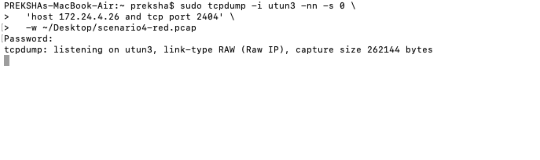

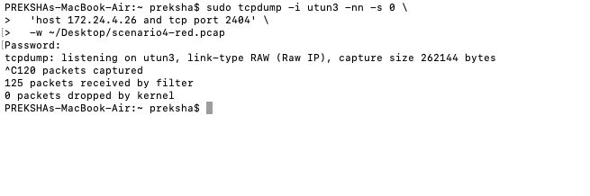

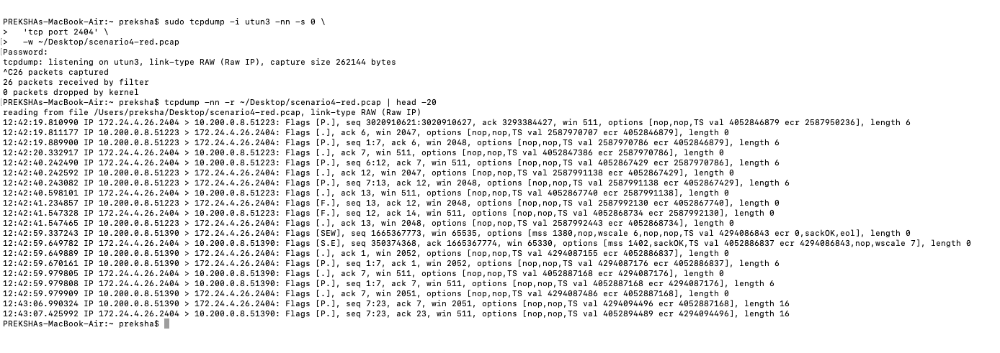

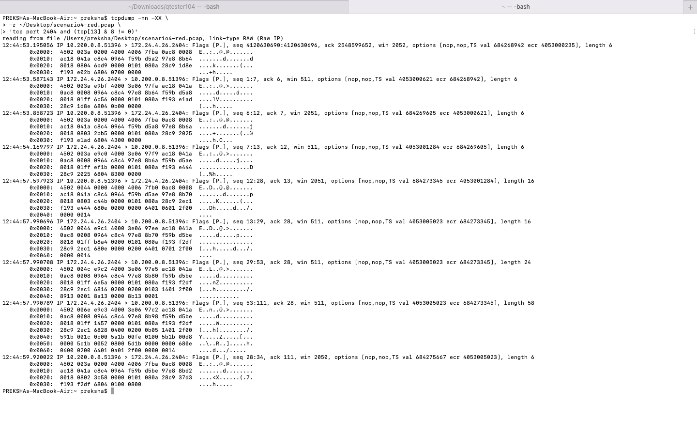

### 3. Confirm the participant exercise is ready

**Command:**

```bash
curl -fsS http://${TARGET}:8095/api/participant/apci/status | python3 -m json.tool
```

**Why:** This is an explicitly supplied exercise interface, not a discovered IEC-104 vulnerability. A status of `IDLE` indicates no bounded experiment is currently running; an administrator must have preconfigured the gateway for the participant VPN IP.

**Observed:** `status: IDLE`, no earlier active process.

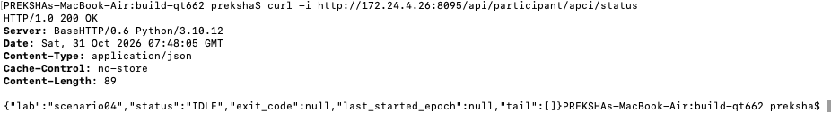

**Early incident-gating checks:** Before a qualifying telemetry-loss event, the incident API showed monitoring state, and the SCL handoff was unavailable. This is useful context for why the Scenario 5 hint is event-gated rather than a permanently exposed file.

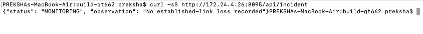

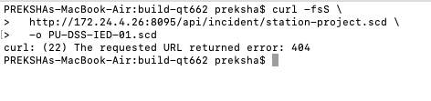

### 4. Invoke the fixed, bounded APCI experiment

**Command (once, while the lab is authorised and ready):**

```bash
curl -i -X POST \
  http://${TARGET}:8095/api/participant/apci \
  -H 'Content-Type: application/json' \
  -d '{"exercise":"SCENARIO04_APCI"}'
```

**Why:** The endpoint requests one fixed training exercise; it does not accept arbitrary destination IPs or commands. The helper modifies selected IEC-104 I-frame transmit sequence counters **inside** the isolated master/outstation path. `202 STARTED` means only that the request was accepted. If the gateway responds `429`, respect its cooldown.

**Observed:** HTTP `202` and `status: STARTED` with an experiment process identifier.

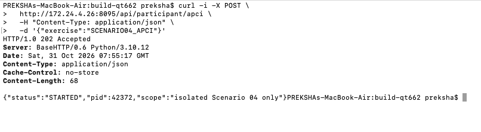

**Additional launch evidence:** An earlier successful request also returned HTTP `202` for the fixed exercise. Repeated attempts are not part of the required walkthrough; a participant must respect the enforced cooldown.

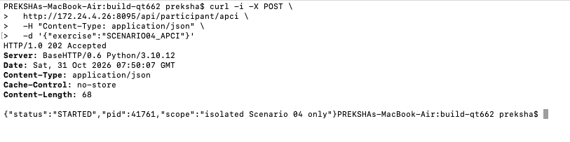

### 5. Examine the bounded experiment status

**Command:**

```bash
curl -fsS http://${TARGET}:8095/api/participant/apci/status | python3 -m json.tool
```

**Why:** Read-only experiment status helps correlate activity with downstream telemetry symptoms. The log identifiers are **runner reports**, not independent packet evidence.

**Observed:** The status tail included `SCENARIO04_ISOLATED_QUEUE_ACTIVE`, `LAB_APCI_CHANGED old=2232 new=4232`, and `LAB_APCI_TOTAL_MODIFIED=18`. The run later returned `IDLE`, `exit_code: 0`.

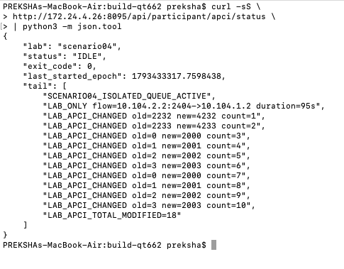

**Additional live event evidence:** The intermediate status response exposed the current experiment and recent event tail. These messages come from the training runner, not from independently collected defender packets.

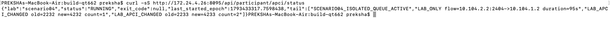

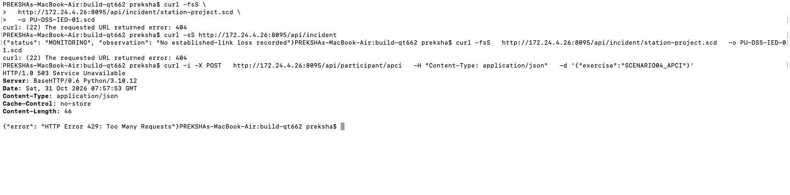

### 6. Verify native SCADA communication impact

**Commands:**

```bash
curl -fsS http://${TARGET}:8095/api/state | python3 -m json.tool
curl -fsS http://${TARGET}:8095/api/incident | python3 -m json.tool
```

**Why:** Confirm the consequence on the **legitimate master**, not just the participant connection. An incident state alone does not establish the packet-level cause.

**Observed during the attack:** `IEC104_TELECONTROL_LOST`, `telecontrol_online: false`, master `DISCONNECTED`, and `ACTIVE` `DISPATCH_TELEMETRY_LOSS`. One incident response reported about **38.44 seconds** of stale telemetry.

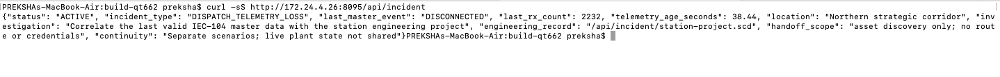

### 7. Confirm impact in the operator HMI

**Action:** Open `http://<ip>:8095/` in the participant browser while the disruption is active.

**Why:** This is the operator-facing effect of the native-master failure.

**Observed:** The HMI displayed `IEC104_TELECONTROL_LOST`, master `STALE / LOST`, about **58.52 seconds** telemetry age and a linked engineering investigation.

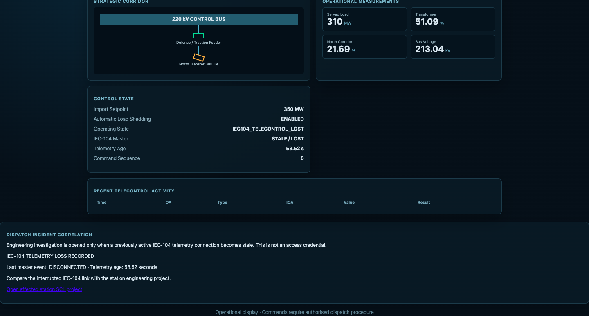

### 8. Understand CTF scoring and recovery

The platform's `Service-Availability-TTP.yml` is a **defender-side scoring check**. It was tested separately: while the disruption occurred, it returned `SERVICE_STATUS:DOWN` (exit code 1). Before and after the bounded attack, it returned `UP` (exit code 0). Merely getting HTTP `202` does **not** mean Blue Team points should be deducted. The scoring platform must actually execute and interpret its checker.

**Read-only recovery check:**

```bash
curl -fsS http://${TARGET}:8095/api/state | python3 -m json.tool
```

**Observed after the test:** `DISPATCH_TELECONTROL_HEALTHY`, `telecontrol_online: true`, `DATA_RECEIVED` and a rising receive count. This recovery followed the bounded test ending; it was not caused by a demonstrated Blue Team containment action.

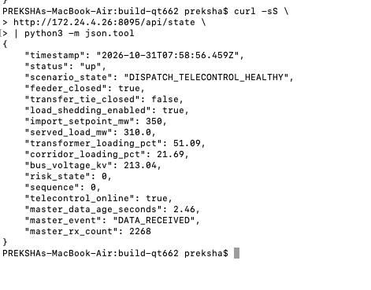

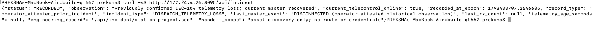

### 9. Retrieve the Scenario 05 engineering handoff

**Command:**

```bash
curl -fsS \
  http://${TARGET}:8095/api/incident/station-project.scd \
  -o PU-DSS-IED-01.scd
```

**Why:** During a valid incident, or while a qualifying incident is retained, the HMI provides an engineering SCL project for the affected substation. The retained record in the supplied evidence is explicitly `operator_attested_prior_incident`, which must not be represented as a newly observed automatic alert.

**Observed:** A roughly 2.2 KB SCL file identifying `PU-Northern-Corridor-Digital-Substation`, bay `BAY01`, IEC 61850 IED `PU-DSS-IED-01` and logical nodes `PTOC`, `PTRC`, `XCBR`, `MMXU`, `RREC`.

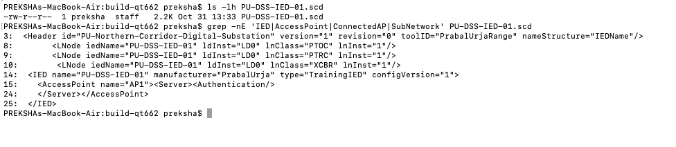

**Additional download evidence:** A second terminal capture documents the SCL retrieval and follow-up examination.

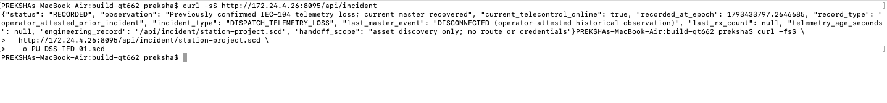

**Inspect it:**

```bash
grep -nE 'IED|AccessPoint|PTOC|PTRC|XCBR|MMXU|RREC|Communication|ConnectedAP' PU-DSS-IED-01.scd
```

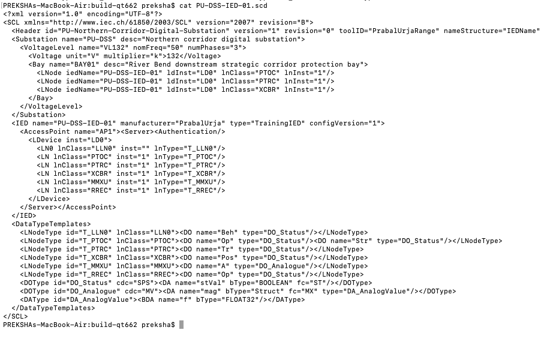

The logical-node search provides a compact visual hint for Scenario 05 without asserting that the file supplies an IP address or credentials.

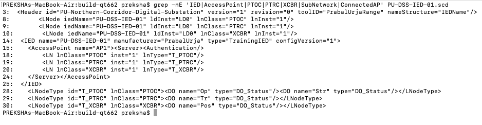

