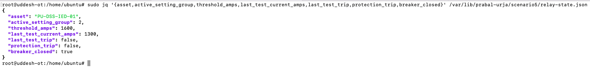
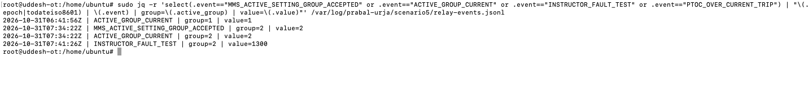
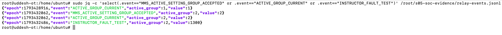
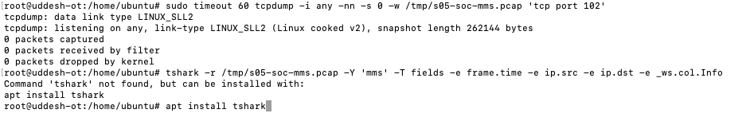
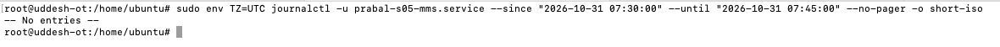
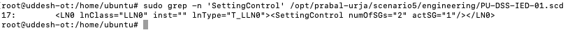

# Prabal Urja | Scenario 05 | Blue Team SOC Investigation

[Exercise overview](../../README.md) · [Scenario 5](../README.md) · [Other team](../Red-Team/README.md)

## Starting information

Scenario 4 supplies the substation SCL engineering file identifying `PU-DSS-IED-01` and its protection model. Continue with the relay setting-group investigation.

Use the address assigned to this scenario by the exercise platform or instructor. Each stage has its own assigned deployment. Follow the engineering clue to identify the next asset, then open that stage using its assigned address.

Run host commands on the assigned defender VM. Replace `<ip>` in each command with the address for the named role: local service, legitimate master, outstation, or participant. Packet filters comparing two endpoints require their respective addresses.

**Walkthrough:** Detection → event and network investigation → containment or restoration procedures → operational checks.


**Case type:** Suspected unauthorised protection-setting modification  
**Affected asset:** `PU-DSS-IED-01`, IEC 61850 MMS relay simulator  
**Incident severity for exercise:** High, protection function deviated from the approved baseline  
**Evidence date:** 31 October 2026  
**Analyst role:** SOC / OT incident response, not an attacking IEC 61850 client  

> **Analyst instructions.** Begin with an alert describing a failed protection response, not with knowledge of the attacker's commands. Use monitoring data, native event records and engineering baselines. Do not reproduce the Red Team MMS write from the SOC workstation. Every screenshot labelled **real** is an image supplied during this investigation.

## 1. Incident intake

**Illustrative analyst-facing alert (scenario narrative, not an observed SIEM alert):**

```text
Case: PU-S05-IR-001
Asset: PU-DSS-IED-01
Reported condition: simulated 1300 A overcurrent exercise did not operate protection
Initial question: equipment failure, approved commissioning activity, or unauthorised setting change?
Severity: High (exercise classification)
```

The real lab does not ship a preconfigured Wazuh or Splunk dashboard. The SOC works from the relay's state file, append-only event records, SCL engineering record, optional network capture and system service logs. This matters because a documented `jq` investigation is not equivalent to a real SIEM alert that was never deployed.

**Evidence chain:** alert -> current process state -> preserved artefacts -> timed event correlation -> baseline comparison -> attribution check -> handoff to OT engineer -> independent recovery test.

## 2. Initial triage: examine protection behaviour

**Blue Team monitoring/forensic Ubuntu host (read-only command):**

```bash
sudo jq '{asset,active_setting_group,threshold_amps,last_test_current_amps,last_test_trip,protection_trip,breaker_closed}' /var/lib/prabal-urja/scenario5/relay-state.json
```

**What the fields mean:** `active_setting_group` names the currently selected relay group; `threshold_amps` is the active modelled pickup; `last_test_current_amps` and `last_test_trip` describe the last injection; `protection_trip` is the present latched state; `breaker_closed` indicates simulated switch position.

**Observed evidence:** group `2`, threshold `1600`, last current `1300`, `last_test_trip: false`, `protection_trip: false`, and `breaker_closed: true`.



**Analyst judgement:** This is not merely an alarm-noise condition. Protection has remained inactive under the instructor's fault test.

## 3. Correlate the relay's native event log

The scenario writes its security-relevant events to `/var/log/prabal-urja/scenario5/relay-events.jsonl`. Filter the event types that identify the selected group and independent test:

```bash
sudo jq -r 'select(.event=="MMS_ACTIVE_SETTING_GROUP_ACCEPTED" or .event=="ACTIVE_GROUP_CURRENT" or .event=="INSTRUCTOR_FAULT_TEST" or .event=="PTOC_OVER_CURRENT_TRIP") | "\(.epoch|todateiso8601) | \(.event) | group=\(.active_group) | value=\(.value)"' /var/log/prabal-urja/scenario5/relay-events.jsonl
```

**Observed timeline (UTC):**

| Timestamp, 31 Oct 2026 | Native event | Interpretation |
|---|---|---|
| 06:41:56 | `ACTIVE_GROUP_CURRENT`, group 1 | Initial approved group observed |
| 07:34:22 | `MMS_ACTIVE_SETTING_GROUP_ACCEPTED`, group 2 | MMS engineering change accepted |
| 07:34:22 | `ACTIVE_GROUP_CURRENT`, group 2 | Group changed in model |
| 07:41:26 | `INSTRUCTOR_FAULT_TEST`, current 1300 A | Independent stress test |

A group-2 setting activation preceded the failed test by **7 minutes 4 seconds**. There was no `PTOC_OVER_CURRENT_TRIP` in the displayed filtered output for that test.



Read the relay event log:
```bash
sudo jq -c 'select(.event=="MMS_ACTIVE_SETTING_GROUP_ACCEPTED" or .event=="ACTIVE_GROUP_CURRENT" or .event=="INSTRUCTOR_FAULT_TEST")' /var/log/prabal-urja/scenario5/relay-events.jsonl
```

**Observed:** four relevant JSON lines: group 1, accepted change to group 2, current group 2, and 1300 A test. The objects contain `epoch`, `event`, `active_group` and `value`; they **do not contain a source IP or engineering username**.



## 4. Investigate network visibility and attribution

A packet capture was attempted only after the attacker activity had concluded:

```bash
sudo timeout 60 tcpdump -i any -nn -s 0 -w /tmp/s05-soc-mms.pcap 'tcp port 102'
```

**Observed:** `0 packets captured`, `0 packets received by filter`. The packet analyser `tshark` was not installed, so it displayed the package-install suggestion rather than decoding a packet.



**For future captures, not an observation of the completed attack:**

```bash
sudo apt-get update && sudo apt-get install -y tshark
sudo tshark -r /tmp/s05-soc-mms.pcap -Y mms -T fields -e frame.time -e ip.src -e ip.dst -e _ws.col.Info
```

A late-started empty capture does not prove the attacker used no network connection. **There is insufficient historical network evidence to attribute this attack to a particular Mac IP**. Do not back-fill a guessed source IP into the incident report. Future exercises should run a rolling capture or deploy switch/TAP/SPAN monitoring before Red Team activity.

## 5. Review service logs without inventing telemetry

The analyst queried journald for the selected incident window:

```bash
sudo env TZ=UTC journalctl -u prabal-s05-mms.service --since '2026-10-31 07:30:00' --until '2026-10-31 07:45:00' --no-pager -o short-iso
```

**Observed:** `-- No entries --`. The scenario's native C implementation records the setting-group event in its dedicated JSONL log, so the absence of matching journald records is a *visibility limitation*. It is not evidence that the MMS event did not happen. The analyst should also verify host time zone and unit name when querying production systems.



## 6. Compare with the approved SCL engineering baseline

The SOC must distinguish a configuration deviation from an authorised temporary commissioning change. The engineering SCL file is used to identify the initial group:

```bash
sudo grep -n 'SettingControl' /opt/prabal-urja/scenario5/engineering/PU-DSS-IED-01.scd
```

**Observed (line 17):**

```xml
<LN0 lnClass="LLN0" inst="" lnType="T_LLN0"><SettingControl numOfSGs="2" actSG="1"/></LN0>
```



**Meaning:** the declared initial active group is 1, while the running system was observed in group 2. This supports a configuration-deviation finding. The analyst should request the protection commissioning/change ticket, responsible engineer, authorisation window and corresponding work order. Until these are checked, classify the event as **suspected unauthorised engineering activity**, not conclusively attributable malicious action.

## 7. Incident declaration and containment decision

**Proposed SOC case summary based on observed evidence:**

```text
Incident category: OT protection engineering configuration deviation
Affected asset: PU-DSS-IED-01
Impact confirmed: 1300 A simulated overcurrent did not trip in group 2
Evidence: native relay-state snapshot, signed group-2 event, test event, SCL baseline
Confidence: high for the setting change and simulator effect
Attribution: unconfirmed, no historical PCAP or source-IP event field
Approval status: unconfirmed, needs change-management review
Immediate escalation: OT operations / protection engineering / incident commander
```

**SOC containment instructions:** Consult the OT control-room lead; assess whether any critical operational process relies on the simulated IED; determine the current legitimate engineering users; isolate an independently verified rogue engineering workstation *at the network or account boundary* where approved. Do not indiscriminately stop the relay, block all TCP/102, or restart the server as the first response.

The lab implementation has no client-identity binding on the setting-group callback, so restoration alone leaves the vulnerability available. Follow-up hardening requires controlled engineering access, explicit approval enforcement in the callback or gateway, trustworthy event fields (source, actor, before/after), and ideally rolling protocol capture.

## 8. Recovery handoff to authorised OT engineering

After incident commander approval, the OT engineer on the Ubuntu scenario host can reset the model with the packaged recovery script:

```bash
sudo /opt/prabal-urja/scenario5/tools/blue_restore.sh
```

**What the script actually does:** sets the instructor test-current file back to `0`, restarts `prabal-s05-mms.service`, waits for the service to return and performs a native MMS read. The restart resets the in-memory active group to 1 and clears the simulator's trip state, but it **briefly interrupts MMS availability**. It does not fix the engineering-authorisation weakness.

**Check the restored state:**

```bash
sudo jq '{active_setting_group,threshold_amps,protection_trip,breaker_closed}' /var/lib/prabal-urja/scenario5/relay-state.json
```

Expected after the reset: group `1`, threshold `800`, protection trip `false`, breaker closed `true`.

## 9. Independently verify recovered protection

**Instructor / authorised OT engineer only:**

```bash
sudo /opt/prabal-urja/scenario5/tools/instructor_fault_test.sh 1300
```

At group 1's 800 A pickup, the 1300 A simulated fault should cause `last_test_trip: true`, `protection_trip: true` and `breaker_closed: false`. This tripped state is the **correct protective response**, even though normal operations would later require a controlled reset.

**Check native service availability using the deployed challenge TTP.** The user's local TTP has been changed from the original archive to an inline shell check. Run it through the CTF platform; do not silently substitute the older ZIP version. The expected result after a successful group-1 test is:

```text
SERVICE_STATUS:UP | REASON:PROTECTION_ACTIVE
```

**Scoring caveat:** The inline TTP can return `UP` solely because the previous group-2 suppression predicate is no longer true. Therefore, the SOC must preserve the actual successful-trip record separately; `UP` by itself is not proof of recovered protection. Once captured and approved, the operator can clear the latched trip by returning the simulator to its normal state using the approved reset method.

>

## Final stage

This is the final stage: relate the selected protection group to the relay response under the instructor-applied 1300 A simulated fault.

[Return to the exercise overview](../../README.md)
